# 斯坦福 CS224N 深度学习自然语言处理 | 第二讲：词向量进阶、多义性与神经网络分类器

> **课程名称**：Stanford CS224N: Natural Language Processing with Deep Learning (Winter 2024)  
> **主讲人**：Prof. Christopher Manning (斯坦福大学)  
> **参考材料**：Lecture 2 Official Slides & Lecture Notes (Word Vectors II & Neural Classifiers)  
> **视频溯源**：[Bilibili BV1U5RNYgEfp (Part 2)](https://www.bilibili.com/video/BV1U5RNYgEfp/?p=2)  
> **版权说明**：课程原版讲义、幻灯片与视频版权归斯坦福大学及主讲教师所有，遵循 CC BY-NC 许可协议。

## 目录

1. [课程导言与知识全景](#1)
2. [Word2Vec 优化深潜：从朴素 Softmax 到负采样](#2-word2vec-softmax)
3. [词向量的几何性质与 Gensim 词类比实操](#3-gensim)
4. [统计计数方法与奇异值分解（SVD）](#4-svd)
5. [GloVe 模型：全局对数双线性架构的终极融合](#5-glove)
6. [词向量的科学评估范式](#6)
7. [一词多义（Polysemy）与词义线性叠加定理](#7-polysemy)
8. [深度学习分类器与前馈神经网络入门](#8)
9. [核心要点总结与技术对比矩阵](#9)
10. [附：官方参考与延伸阅读](#_4)

---

## 1. 课程导言与知识全景

*(参考时间: 00:00:05)*


在第一讲中，我们建立起了分布式词向量（Word Vectors / Word Embeddings）的基本直觉，并探讨了基于预测的 Word2Vec 基础架构（Skip-gram 模型）。本讲作为词向量与基础表征学习的承前启后之作，核心使命是彻底打通词表征的理论全链条，并自然过渡到深度学习的核心工具——神经网络分类器。

本讲的核心脉络围绕以下四个核心问题展开：
1. **Word2Vec 是如何被高效训练的？** 从朴素 Softmax 的归一化计算困境，到基于二元逻辑回归的**负采样（Negative Sampling, SGNS）**数学推导与稀疏梯度更新机制。
2. **预测与计数之争：能否更高效地利用全局统计信息？** 从共现矩阵（Co-occurrence Matrix）与奇异值分解（SVD）的工程瓶颈，深入剖析 Stanford 自主研发的 **GloVe（Global Vectors for Word Representation）** 对数双线性模型及其优美推导。
3. **词向量该如何科学评估？多义词如何表征？** 厘清内部评估（词类比、相似度关联）与外部下游任务评估的辩证关系；借助 Arora 等人（2018）的线性叠加定理，解答“一个向量如何编码多重词义”的高维几何本质。
4. **神经网络分类器如何诞生？** 从上下文窗口分类（以命名实体识别 NER 为切入点），到人工神经元、前馈网络矩阵表达，以及激活函数为何是深层网络的“灵魂”。

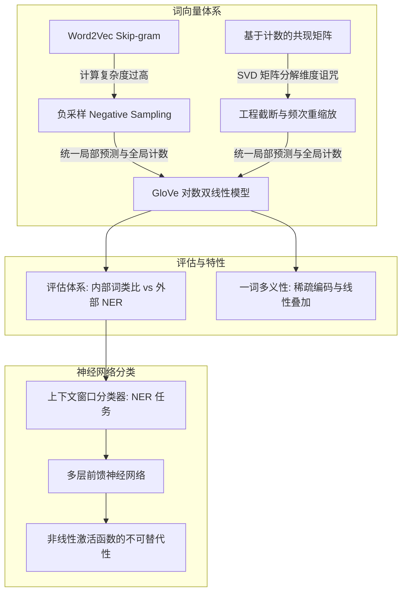

---

## 2. Word2Vec 优化深潜：从朴素 Softmax 到负采样

### 2.1 梯度下降（Gradient Descent）与参数优化步幅

*(参考时间: 00:03:08)*

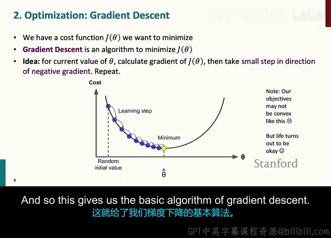

回顾第一讲，Word2Vec 的学习目标是寻找一组参数 $\theta$（即词表中的所有词向量矩阵），以最小化总体损失函数 $J(\theta)$。在最朴素的连续空间优化中，标准算法是**梯度下降（Gradient Descent）**：

$$
\theta^{\text{new}} = \theta^{\text{old}} - \alpha \nabla_{\theta} J(\theta)
$$

其中 $\alpha > 0$ 表示步长（Step Size）或学习率（Learning Rate）。

讲师在此强调了学习率选取的物理直觉：如果损失曲面类似凹凸不平的峡谷，过大的学习率会导致算法直接越过最优点甚至跳向更高梯度的发散区域；而极小但合理的学习率（例如 $10^{-3}$ 到 $10^{-5}$）能够确保参数沿着负梯度方向稳健地下坡。

### 2.2 随机梯度下降（SGD）与海量语料训练

*(参考时间: 00:05:53)*

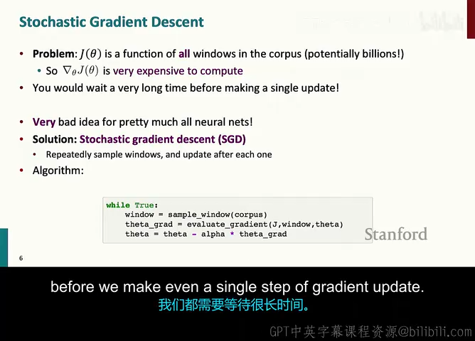

在标准梯度下降（Batch Gradient Descent）中，目标函数 $J(\theta)$ 是全语料库中所有滑动窗口损失的算术平均值：

$$
J(\theta) = \frac{1}{T} \sum_{t=1}^T J_t(\theta)
$$

当语料库包含数十亿甚至数万亿词元（Tokens）时，计算一次精确的全量梯度 $\nabla_{\theta} J(\theta)$ 需要遍历整个语料库，这在大规模语言建模中是极其昂贵且不切实际的。

因此，实际工程中无一例外采用**随机梯度下降（Stochastic Gradient Descent, SGD）**或**小批量梯度下降（Mini-batch Gradient Descent）**：

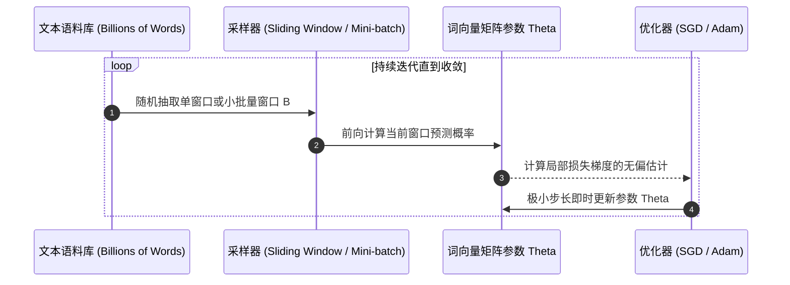

通过以局部窗口梯度的期望作为全局梯度的无偏估计，SGD 可以在遍历极少样本后立即更新参数，不仅极大地加速了收敛速度，更利用随机采样引入的轻微扰动帮助模型逃离局部劣质极小点。

### 2.3 朴素 Softmax 的归一化绝境

*(参考时间: 00:08:30)*

在最原始的 Skip-gram 模型中，给定中心词 $c$ 时，出现上下文词 $o$ 的条件概率由**朴素 Softmax（Naïve Softmax）**给出：

$$
P(o \mid c) = \frac{\exp(u_o^T v_c)}{\sum_{w \in V} \exp(u_w^T v_c)}
$$

其中：
- $v_c \in \mathbb{R}^d$ 表示词 $c$ 作为中心词（Center Word）时的表征向量；
- $u_o \in \mathbb{R}^d$ 表示词 $o$ 作为上下文/外部词（Outside Context Word）时的表征向量；
- $V$ 是词汇表（Vocabulary）。

> **计算瓶颈瓶颈所在**：
> 分母部分必须对词表 $V$ 中的**每一个词**计算内积并求和。当真实词表规模达到 $|V| \approx 10^5 \sim 10^7$ 时，单个窗口单次计算的开销是 $O(|V| \cdot d)$。在大规模语料训练时，这一归一化常数（Partition Function）将使得算法举步维艰。

### 2.4 负采样（Negative Sampling, SGNS）的数学本质与推导

*(参考时间: 00:28:13)*

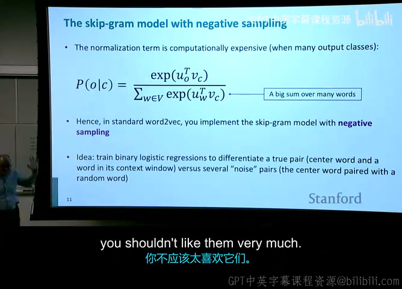

为了彻底根除对整个词表求和的昂贵开销，Mikolov 等人（2013）在论文《Distributed Representations of Words and Phrases and their Compositionality》中提出了**负采样（Negative Sampling, SGNS）**。

#### 核心思想：二元逻辑回归分类器
负采样的核心直觉非常巧妙：将原来多分类（从 $|V|$ 个词中选出上下文词）的多项逻辑回归问题，转化为一系列相互独立的**二元逻辑回归（Binary Logistic Regression）**任务：
- **正样本（True Pair）**：真实共现在当前上下文窗口中的词对 $(c, o)$，模型应当最大化其共现概率；
- **负样本（Noise Pairs）**：从词表中随机挑选 $k$ 个与中心词 $c$ 并无实际共现的噪声词 $w_k \sim P_n(w)$，构造负词对 $(c, w_k)$，模型应当最小化其共现概率。

定义标准的 Sigmoid 激活函数：

$$
\sigma(x) = \frac{1}{1 + \exp(-x)}
$$

其关键性质在于：$1 - \sigma(x) = \sigma(-x)$。

#### 目标函数推导
对于正词对 $(c, o)$，模型预测其为真实共现的概率为 $\sigma(u_o^T v_c)$；
对于负词对 $(c, w_k)$，其不为真实共现的概率为 $1 - \sigma(u_{w_k}^T v_c) = \sigma(-u_{w_k}^T v_c)$。

因此，单个上下文词预测的最大化对数似然目标为：

$$
\log P(D = 1 \mid c, o) + \sum_{k=1}^K \log P(D = 0 \mid c, w_k)
$$

改写为通常最小化的目标损失函数形式：

$$
J_{\text{SGNS}}(u_o, v_c, U) = -\log \sigma(u_o^T v_c) - \sum_{k=1}^K \log \sigma(-u_{w_k}^T v_c)
$$

```mermaid
graph LR
    C[中心词向量 vc] --> DotPos[内积 u_o^T vc]
    O[正上下文词 u_o] --> DotPos
    DotPos --> SigPos[Sigmoid: 目标逼近 1]
    
    C --> DotNeg[内积 u_k^T vc]
    NegWords[k 个随机负采样词 u_k] --> DotNeg
    DotNeg --> SigNeg[Sigmoid(-u_k^T vc): 目标逼近 1]
    
    SigPos --> Loss[最小化 SGNS 目标损失]
    SigNeg --> Loss
```

#### 负采样分布：3/4 次方的数学直觉
负样本并非完全均匀随机抽取，而是按照经过平滑的单字分布（Unigram Distribution）采样：

$$
P_n(w) = \frac{U(w)^{3/4}}{Z} = \frac{U(w)^{3/4}}{\sum_{w' \in V} U(w')^{3/4}}
$$

> **为什么是 $3/4$ 次方？**
> 在自然语言中，词频遵循经典的齐夫定律（Zipf's Law）：极少数高频虚词（the, of, and）占据了绝大部分频次，而绝大部分专业词汇处于长尾（罕见词）。
> - 若使用原始频次 $U(w)^1$，负样本中全都是虚词，长尾生僻词永远无法被负采样选到；
> - 若使用均匀分布 $U(w)^0$，罕见词被采样的概率过大，惩罚失真。
> - $3/4$ 次方是一剂极其优雅的经验调和剂：它轻微削弱了超高频词的权重，相对提升了低频长尾词被采样的概率（例如：频次为 $0.99$ 的词在 $3/4$ 次方后依然是 $\approx 0.992$，而频次为 $0.0001$ 的低频词提升到了 $0.001$，相对采样概率提升了整整一个数量级）。

### 2.5 稀疏梯度与分布式更新工程架构

*(参考时间: 00:32:00)*

在每个局部窗口中，实际参与前向与反向传播的词极其有限：中心词 1 个，窗口上下文词最多 $2m$ 个，负采样词最多 $2km$ 个。总共涉及的词向量不超过数十个。
这意味着，整个大小为 $|V| \times d$ 的全量嵌入矩阵的梯度 $\nabla_{\theta} J(\theta)$ 是**极度稀疏（Extremely Sparse）**的。

在实际代码实现与大规模分布式训练（如 PyTorch、TensorFlow）中：
- 不能将整个密集矩阵从 GPU/参数服务器来回搬运；
- 必须使用稀疏梯度操作（Sparse Matrix Row Slice Update）或哈希映射表（Hash Map），仅将实际发生变化的特定词向量行写回主内存，从而实现百亿规模词表的高效扩展。

---

## 3. 词向量的几何性质与 Gensim 词类比实操

### 3.1 线性语义偏移与词类比（Word Analogies）

*(参考时间: 00:16:05)*

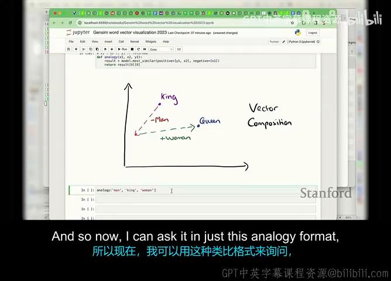

在 Word2Vec 学到的连续向量空间中，最令人着迷的特性莫过于其**线性代数性质**：两个词向量之间的差值向量往往编码了特定的语义或语法关系。

最著名的经典范式即为**词类比（Word Analogy）**：
> $\text{man} : \text{king} :: \text{woman} : ?$  
> “男人之于国王，正如女人之于——女王（Queen）。”

在向量空间中，这一推理直接对应于空间矢量的加减法：

$$
d = \arg\max_{x \in V \setminus \{a, b, c\}} \cos(v_x, v_b - v_a + v_c)
$$

在上述例子中：

$$
v_{\text{king}} - v_{\text{man}} + v_{\text{woman}} \approx v_{\text{queen}}
$$

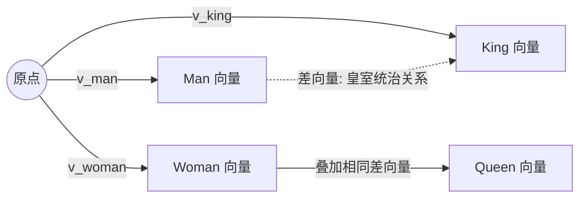

### 3.2 语法与语义维度的对齐性
通过在 Gensim 中探索词向量空间，可以发现大量类似的语义关系：
- **首都与国家**：$v_{\text{Paris}} - v_{\text{France}} + v_{\text{Italy}} \approx v_{\text{Rome}}$
- **词态与语法**：$v_{\text{walking}} - v_{\text{walk}} + v_{\text{swam}} \approx v_{\text{swimming}}$
- **比较级与最高级**：$v_{\text{better}} - v_{\text{good}} + v_{\text{fast}} \approx v_{\text{faster}}$

讲师提醒：在执行余弦相似度检索时，算法必须将原始输入的查询词（如 king, man, woman）从候选结果中剔除，否则由于输入词自身的极高相似度，最临近词可能直接返回输入词本身。

---

## 4. 统计计数方法与奇异值分解（SVD）

### 4.1 既然有全局共现，为何还要遍历语料？

*(参考时间: 00:35:15)*

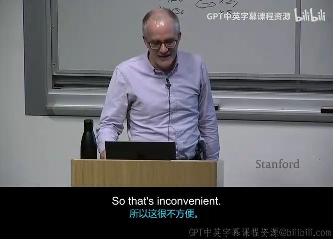

Word2Vec 的滑动窗口预测算法效果显著，但从计算视角看存在一种哲学上的反思：
> “我们为什么要开着小窗口，反反复复在几十亿词的文本上跑上一轮又一轮？为什么不直接统计全局语料中所有词之间的共现次数，一步到位？”

#### 共现矩阵（Co-occurrence Matrix $X$）的构建方式
1. **基于文档（Document-based）**：统计词是否出现在同一篇文档中。这构成了经典的信息检索矩阵与潜在语义分析（LSA/LSI），其空间表征更偏向于宏观的“文档主题”（如体育、医疗）。
2. **基于局部窗口（Window-based）**：类似于 Word2Vec，设置滑动窗口（如左右 5 到 10 个词），统计两个词在窗口内共同出现的频次。这种矩阵能够敏锐捕获句法（Syntactic）与微观语义（Semantic）信息。

假设语料库极小：
- `I like deep learning.`
- `I like NLP.`
- `I enjoy flying.`

其窗口大小为 1 的对称共现矩阵即为一个对称方阵 $X \in \mathbb{R}^{|V| \times |V|}$。

### 4.2 SVD 降维（Singular Value Decomposition）及其致命缺陷

*(参考时间: 00:37:04)*

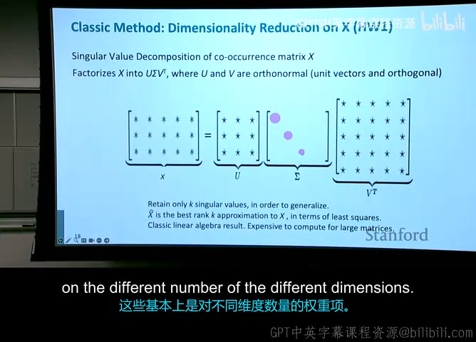

得到庞大的共现矩阵 $X$ 后，由于词表高达 $|V| \approx 10^5$，矩阵维度极高且极其稀疏。为了获得与 Word2Vec 类似的低维稠密向量（Dense Vectors，例如 100~300 维），经典的线性代数解法是执行**奇异值分解（SVD）**：

$$
X = U \Sigma V^T
$$

通过仅保留前 $k$ 个最大的奇异值及其对应的特征向量，可以将 $X$ 最佳截断为秩为 $k$ 的低秩近似矩阵 $\hat{X}$：

$$
\hat{X} = U_k \Sigma_k V_k^T
$$

此时 $U_k$ 的每一行即为相应词的 $k$ 维稠密词向量。

> **SVD 处理原始共现矩阵的致命工程痛点**：
> 1. **计算复杂度极其恐怖**：对 $|V| \times |V|$ 的方阵进行精确 SVD 分解，复杂度高达 $O(|V|^3)$，对于 10 万词表完全不可接受。
> 2. **高频虚词的毁灭性干扰**：在原始计数矩阵中，超高频虚词（the, a, is）的共现频次呈指数级膨胀，主导了 SVD 的主要奇异值方向，使得词向量被语法停用词彻底污染。
> 3. **新词无法增量更新**：一旦有新词或新语料进入，整个矩阵需要重新从头分解。

### 4.3 工程补丁：COALS 模型与启发式变换

*(参考时间: 00:39:20)*

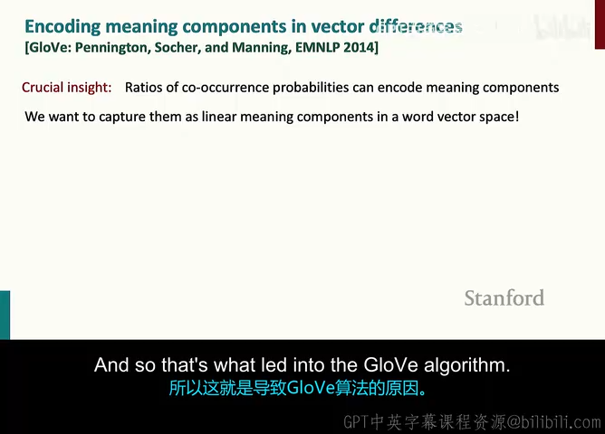

在 2000 年代中期，Doug Rohde 等人提出了 **COALS 模型（Correlated Occurrence Analogue to Lexical Semantics, 2005）**，尝试为原始计数矩阵打上一系列工程“补丁”：
- **频次对数化或截断**：将计数替换为 $\log(1 + X_{ij})$ 或设置阈值上限 $\min(X_{ij}, 100)$，防止虚词垄断；
- **距离衰减窗口（Ramped Window）**：窗口内距离中心词越近的词赋予更高的权重（如 $1/d$），越远权重越低；
- **皮尔逊相关系数（Pearson Correlation）**：使用相关性替代原始频次，并将负相关全部置零。

虽然这些工程手段让基于计数的模型产生了一定语义结构，但它仍然缺乏统一的理论指导，直到 GloVe 的诞生。

---

## 5. GloVe 模型：全局对数双线性架构的终极融合

### 5.1 核心思想：概率比率（Ratio of Co-occurrence Probabilities）

*(参考时间: 00:41:53)*

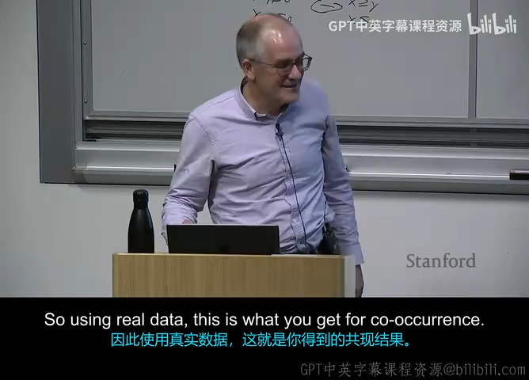

2014 年，Jeffrey Pennington、Richard Socher 与 Christopher Manning 共同发表了里程碑论文《GloVe: Global Vectors for Word Representation》。

GloVe 的核心洞见在于：**真正编码词汇深层语义信息的，不是单个共现计数的绝对值，而是不同词对之间共现概率的比率（Ratio of Co-occurrence Probabilities）！**

考虑三个目标词：
- 探测词 $i = \text{ice}$（冰）
- 探测词 $j = \text{steam}$（蒸汽）
- 比较词 $k$（如 solid, gas, water, fashion）

设 $P(k \mid i) = \frac{X_{ik}}{X_i}$ 为词 $i$ 的上下文中出现词 $k$ 的条件概率。

| 概率与比率 | $k = \text{solid}$ (固体) | $k = \text{gas}$ (气体) | $k = \text{water}$ (水) | $k = \text{fashion}$ (时尚) |
| :--- | :--- | :--- | :--- | :--- |
| $P(k \mid \text{ice})$ | 较大 ($1.9 \times 10^{-4}$) | 极小 ($6.6 \times 10^{-5}$) | 极大 ($3.0 \times 10^{-3}$) | 极小 ($1.7 \times 10^{-5}$) |
| $P(k \mid \text{steam})$ | 极小 ($2.2 \times 10^{-5}$) | 较大 ($7.8 \times 10^{-4}$) | 极大 ($2.2 \times 10^{-3}$) | 极小 ($1.8 \times 10^{-5}$) |
| $\frac{P(k \mid \text{ice})}{P(k \mid \text{steam})}$ | **极大 (8.9)** | **极小 (0.085)** | **接近 1 (1.36)** | **接近 1 (0.96)** |

> **物理结论**：
> - 当 $k$ 与 ice 强相关、与 steam 弱相关时（如 solid），比率远大于 1；
> - 当 $k$ 与 steam 强相关、与 ice 弱相关时（如 gas），比率远小于 1；
> - 当 $k$ 与两者都相关（如 water）或都无关（如 fashion）时，比率趋近于 1。
>
> 这证明：**共现概率的比率能够极其纯净地剥离背景噪声，精准刻画出词汇之间的相对差异维度！**

### 5.2 对数双线性模型数学推导

*(参考时间: 00:44:36)*

GloVe 希望寻找一个函数 $F$，用词向量的线性差值来拟合这一比率：

$$
F(w_i, w_j, \tilde{w}_k) = \frac{P(k \mid i)}{P(k \mid j)}
$$

为了保持向量空间的线性结构，函数的自变量应当依赖于向量差 $(w_i - w_j)$；又因为输出是标量，最自然的运算是点积：

$$
F((w_i - w_j)^T \tilde{w}_k) = \frac{P(k \mid i)}{P(k \mid j)}
$$

进一步，考虑群同态性质：将减法同态映射为除法，最直接的函数形式是指数函数 $F = \exp$：

$$
\exp((w_i - w_j)^T \tilde{w}_k) = \frac{\exp(w_i^T \tilde{w}_k)}{\exp(w_j^T \tilde{w}_k)} = \frac{P(k \mid i)}{P(k \mid j)}
$$

因此，对分子分母分别成立：

$$
w_i^T \tilde{w}_k = \log P(k \mid i) = \log X_{ik} - \log X_i
$$

注意到左侧内积 $w_i^T \tilde{w}_k$ 是对称的，而右侧包含不对称的 $\log X_i$。为了保持对称性，将 $\log X_i$ 吸收进偏置项 $b_i$，并为上下文词引入独立的偏置项 $\tilde{b}_k$：

$$
w_i^T \tilde{w}_k + b_i + \tilde{b}_k = \log X_{ik}
$$

### 5.3 权重截断函数与 GloVe 损失函数

*(参考时间: 00:46:04)*

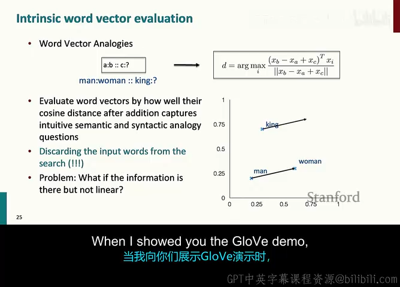

直接拟合上述方程存在两个问题：
1. 当 $X_{ik} = 0$ 时，$\log 0$ 无定义；
2. 罕见词的噪声过大，而高频词的误差会被过度放大。

GloVe 引入了一个加权最小二乘回归目标函数：

$$
J = \sum_{i,j=1}^V f(X_{ij}) \left( w_i^T \tilde{w}_j + b_i + \tilde{b}_j - \log X_{ij} \right)^2
$$

其中加权函数 $f(x)$ 满足三个关键条件：
1. $f(0) = 0$（当两个词从未共现时，直接跳过计算，维持稀疏性）；
2. $f(x)$ 随着 $x$ 单调递增，高频共现词拥有更大权重；
3. 对极高频词设置上限平顶，防止被虚词主导。

经典加权函数形式为：

$$
f(x) = \begin{cases} 
\left( \frac{x}{x_{\max}} \right)^\alpha & \text{if } x < x_{\max} \\
1 & \text{otherwise}
\end{cases}
$$

在论文中，参数通常取 $x_{\max} = 100, \alpha = 0.75$。

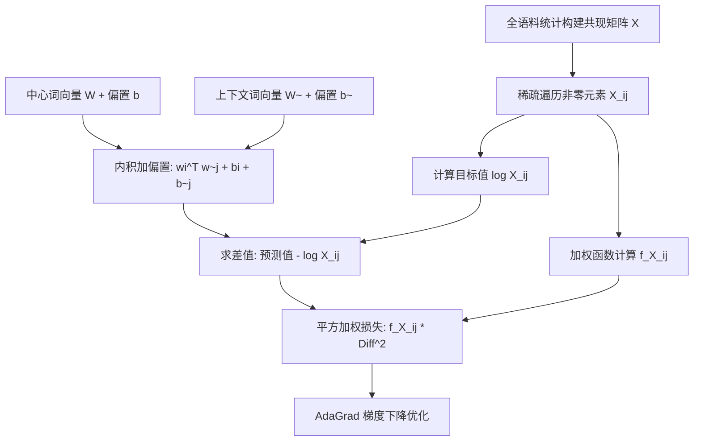

> **最终词向量的选择细节**：
> 在训练结束时，模型为每个词输出了两个向量：中心词向量 $W$ 和上下文词向量 $\tilde{W}$。由于共现矩阵是对称的，理论上两者等价。在实践中，直接将两者相加作为最终的词向量：
> $$V_{\text{final}} = W + \tilde{W}$$
> 实验表明，这种简单的相加操作能够有效平滑训练过程中的随机噪声，并在词类比和下游任务中获得稳定约 1% 的性能提升。

---

## 6. 词向量的科学评估范式

### 6.1 内部评估（Intrinsic）vs 外部评估（Extrinsic）

*(参考时间: 00:46:34)*

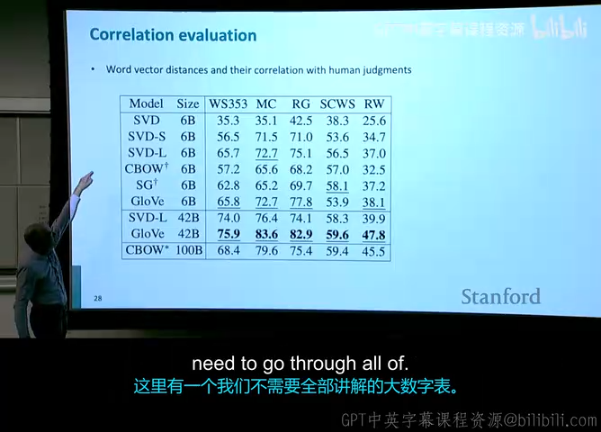

在自然语言处理中，表征模型的评价指标可分为两大家族：


### 6.2 经典内部基准：词类比与 WordSim-353
1. **词类比任务（Word Analogies）**：包含句法类比（如 quick:quicker :: fast:faster）与语义类比（如 Athens:Greece :: Oslo:Norway）。
2. **人类判断相似度相关系数（WordSim-353）**：让人类对词对的语义亲疏给出 0~10 分的打分（例如 `tiger` 与 `cat` 得 7.35 分，`stock` 与 `jaguar` 得 0.92 分），然后计算词向量余弦相似度与人类评分的斯皮尔曼等级相关系数（Spearman Rank Correlation $\rho$）。

### 6.3 超参数敏感性实验结论（GloVe 论文消融实验）

*(参考时间: 00:51:13)*

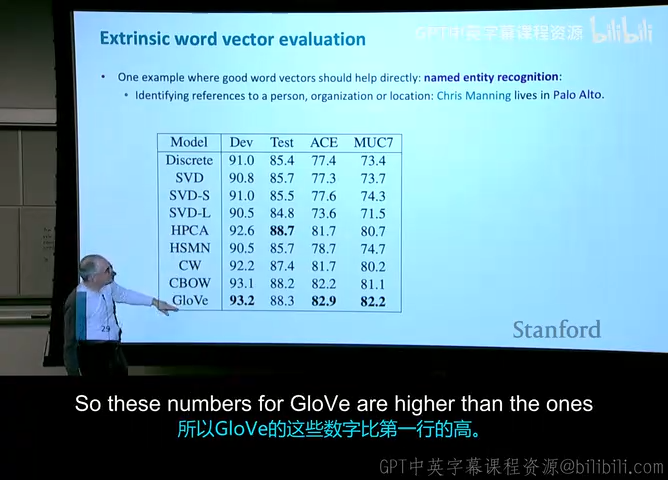

讲师深度拆解了 GloVe 论文中的核心消融实验数据，给出了宝贵的工程实战结论：
1. **向量维度（Dimension）**：随着维度从 50 提升到 200~300，模型性能稳步提升；但超过 300 维后，边际效用迅速递减（Diminishing Returns）。绝大多数应用中 300 维是最佳性价比之选。
2. **窗口大小（Window Size）与对称性**：
   - **小窗口（1~3）与单向非对称窗口**：极度利于捕获**句法（Syntactic）特征**（语法角色、词性等依附于局部紧邻词序）；
   - **大窗口（8~10）与双向对称窗口**：能够广泛收集全局语境，显著提升**语义（Semantic）特征**的表征质量。
3. **语料库规模与性质**：语料越多通常效果越好（如 42B Common Crawl 优于 6B Wikipedia），但语料质量与时效性至关重要——维基百科由于其高质量百科事实结构，在地理与实体类比上往往超越陈旧过时的新闻语料（如 Gigaword）。

---

## 7. 一词多义（Polysemy）与词义线性叠加定理

### 7.1 一词多义的直觉危机：以 “Pike” 为例

*(参考时间: 00:53:01)*

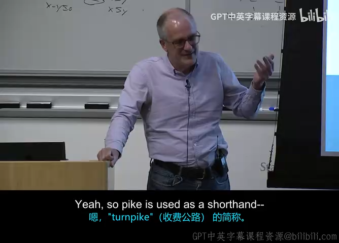

传统词向量模型的一个巨大隐忧在于：**每个词仅分配了一个固定的向量**。但在自然语言中，一词多义现象极其普遍，越是常见的高频词，含义往往越发散。

讲师以英文单词 **“pike”** 为例，在课堂上展开了趣味互动：
- 尖锐的长矛/冷兵器（A sharp spear or staff）；
- 某种淡水肉食鱼（A type of elongated fish）；
- 高速收费公路（Turnpike 的简称，源于古代横在路上的长矛路障）；
- 奥运会跳水与体操中的“屈体”姿势（A pike position in diving）；
- 动词“刺穿”或“赶路”；
- 澳大利亚俚语：“临阵退缩/放鸽子”（To back out or chicken out of something: *"He piked!"*）。

> **灵魂发问**：将所有这些风马牛不相及的词义粗暴地压缩在同一个 300 维向量里，得到的是一个毫无意义的“语义大杂烩”，还是具有某种深刻的数学规律？

### 7.2 Arora 线性叠加定理（Linear Superposition Theorem）

*(参考时间: 00:57:37)*

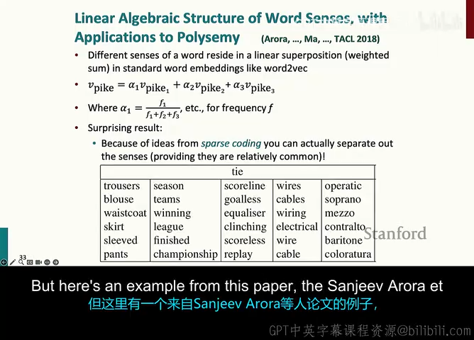

早期学者（如 Huang et al., 2012）曾试图对词的上下文聚类，为不同词义训练不同的向量（如 $\text{bank}_1, \text{bank}_2$），但工程极其繁琐，且在没有上下文时难以分配。

2018 年，Sanjeev Arora、Yuanzhi Li、Tengyu Ma 等人在 TACL 上发表了一篇极富震撼力的理论论文《Linear Algebraic Structure of Word Senses, with Applications to Polysemy》，彻底颠覆了人们的认知：

$$
v_{\text{pike}} = \sum_{i} \alpha_i v_{\text{pike}, i}
$$

其中：
- $v_{\text{pike}, i}$ 表示词的第 $i$ 个具体明确词义的纯净向量；
- 权重系数 $\alpha_i = \frac{f_i}{\sum_j f_j}$，直接正比于该词义在语料库中出现的经验频次！

> **为什么可以在不丢失信息的前提下直接线性相加？**
> 这一反直觉现象由**高维几何（High-Dimensional Geometry）与压缩感知/稀疏编码（Sparse Coding）**共同保证：
> 1. 在一个高达 300 维的空间中，存在着天文数字般的“几乎相互正交”（Nearly Orthogonal）的方向；
> 2. 真实语言概念在语义空间中是极度稀疏的；
> 3. 当多个不相干的独立概念向量线性相加后，由于高维正交性，它们彼此之间的相互干扰（Cross-talk）极微弱。利用字典学习（Dictionary Learning）或稀疏自编码技术，我们完全可以**无损地将一个混合词向量精准分解回它的各个孤立词义分量！**

---

## 8. 深度学习分类器与前馈神经网络入门

### 8.1 命名实体识别（NER）与上下文窗口分类范式

*(参考时间: 01:03:48)*

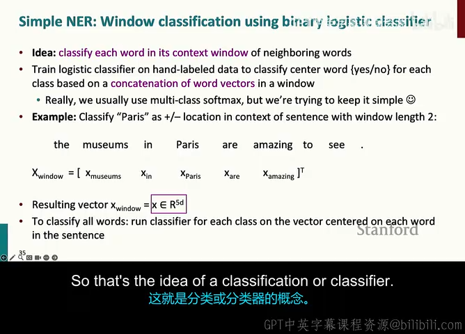

为了将词向量赋能于实际下游任务，讲师引入了经典任务——**命名实体识别（Named Entity Recognition, NER）**：从连续文本中定位并分类专有名词（人名 PER、地点 LOC、机构 ORG、时间 DATE 等）。
- 示例：`Last night, Paris Hilton wowed in a sequin gown.`（此处的 Paris Hilton 是人名 PER）；
- 示例：`...in the Hilton Hotel in Paris in April 1989.`（此处的 Hilton Hotel 是机构/建筑，Paris 是地点 LOC）。

#### 窗口分类器（Window Classifier）机制
为了区分多义实体，必须结合中心词周围的上下文。构建一个跨度为 $2m+1$ 的滑动窗口，将窗口内所有词向量首尾拼接成一个超长特征向量：

$$
x_{\text{window}} = \begin{bmatrix} x_{t-m} \\ \vdots \\ x_t \\ \vdots \\ x_{t+m} \end{bmatrix} \in \mathbb{R}^{(2m+1)d}
$$

例如，当窗口半径 $m=2$，维度 $d=300$ 时，$x_{\text{window}} \in \mathbb{R}^{1500}$。直接将其送入分类器判断中心词 $x_t$ 的实体标签。

### 8.2 从人工神经元到多层感知机（MLP）

*(参考时间: 01:15:35)*

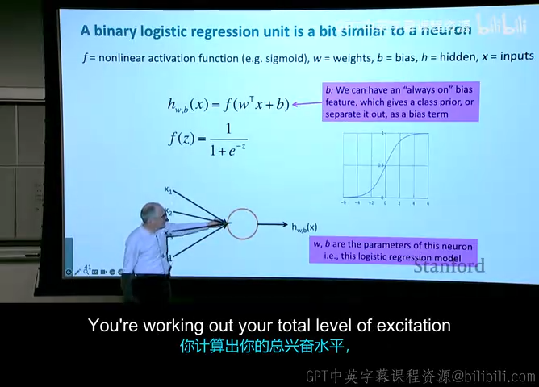

经典的二元逻辑回归单元本质上就是一个最简单的**人工神经元（Artificial Neuron）**：

$$
h_{w,b}(x) = f(w^T x + b)
$$

其中 $w$ 为权重向量，$b$ 为偏置标量（代表类别先验），$f$ 为非线性激活函数（如 Sigmoid）。

如果我们并行运行一组（例如 $H$ 个）逻辑回归单元，就得到了神经网络的一个**隐层（Hidden Layer）**。用紧凑的矩阵记号表达：

$$
z = W x + b
$$

$$
a = f(z) = f(W x + b)
$$

其中 $W \in \mathbb{R}^{H \times D}, b \in \mathbb{R}^H$，激活函数 $f$ 逐元素（Element-wise）应用。

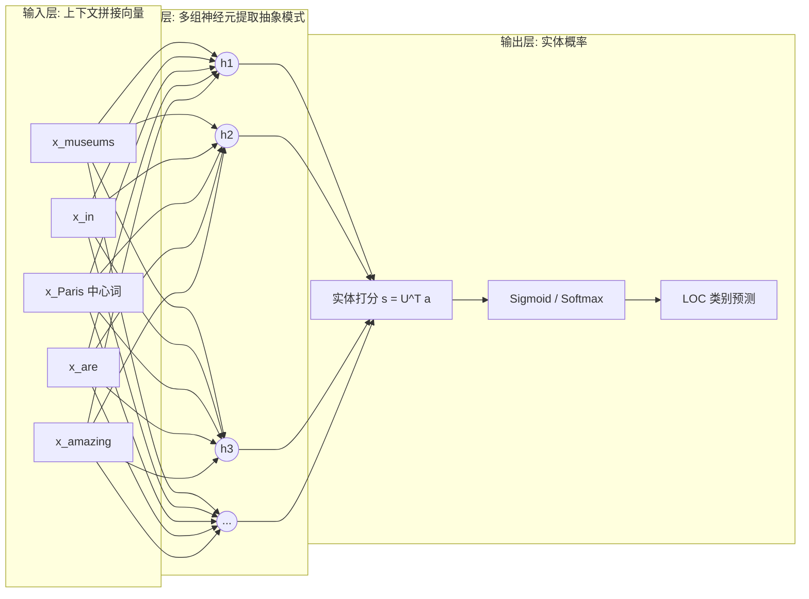

### 8.3 为什么必须存在非线性激活函数？

*(参考时间: 01:17:24)*

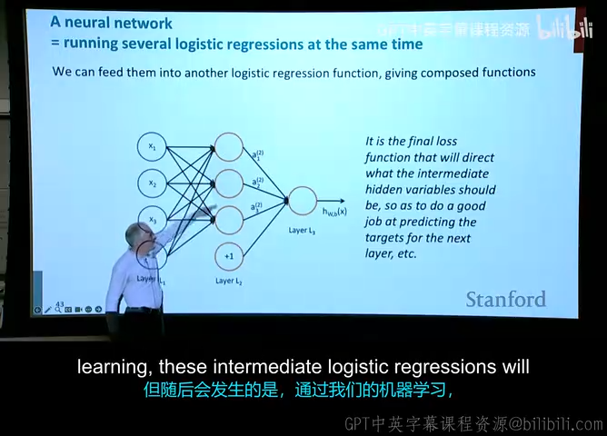

在全课的尾声，讲师提出了一个奠基性的理论命题：**为什么神经网络不能只进行矩阵乘法？为什么必须在层与层之间插入非线性激活函数 $f$？**

#### 线性折叠定理（Linear Collapse）
假设我们构建了一个没有激活函数（即 $f(z) = z$）的深层前馈神经网络：

$$
z_1 = W_1 x + b_1
$$

$$
z_2 = W_2 z_1 + b_2
$$

$$
y = W_3 z_2 + b_3
$$

展开两层复合：

$$
y = W_3 (W_2 (W_1 x + b_1) + b_2) + b_3 = (W_3 W_2 W_1) x + (W_3 W_2 b_1 + W_3 b_2 + b_3)
$$

定义复合权重 $W^* = W_3 W_2 W_1$ 和复合偏置 $b^* = W_3 W_2 b_1 + W_3 b_2 + b_3$，则：

$$
y = W^* x + b^*
$$

> **关键推论**：
> 无论你堆叠了 10 层、100 层还是 1000 层纯线性变换，整个复杂的深层网络在数学上**完全等价于一个单层的线性变换**！
> - 纯线性变换只能学习线性超平面，无法解决哪怕最简单的异或（XOR）问题，更不可能拟合人类语言中错综复杂的非线性逻辑；
> - 唯有引入非线性激活函数（Sigmoid, Tanh, ReLU, GELU），网络才拥有了万能逼近能力（Universal Approximation Theorem），才能在更高维度的隐层空间中层层剥离语义，实现高度抽象的概念表征！

---

## 9. 核心要点总结与技术对比矩阵

为方便快速复习，下表归纳了本讲讨论的三大词表征技术路线的本质异同：

| 维度 / 特性 | 原始 SVD 分解 | Word2Vec (SGNS) | GloVe |
| :--- | :--- | :--- | :--- |
| **基础算法类型** | 全局矩阵分解 (Matrix Factorization) | 局部滑动窗口预测 (Local Context Prediction) | 全局加权对数双线性回归 (Global Log-bilinear Regression) |
| **利用的数据信息** | 全局词汇-词汇共现计数 | 局部窗口词对样本点 | 全局非零共现计数矩阵 |
| **计算复杂度** | $O(\|V\|^3)$，极难扩展到超大词表 | $O(T \cdot K)$，随全语料长度 $T$ 线性增长 | $O(\|X\|)$，随非零共现对数量增长，快且可高度并行 |
| **高频词处理策略** | 启发式截断或取对数 (COALS) | 负采样加权采样分布 $U(w)^{3/4}$ | 平滑加权函数 $f(X_{ij}) = (X/X_{\max})^{0.75}$ |
| **可解释性与性质** | 几何正交奇异向量 | 局部方向向量，支持线性词类比 | 直接建模共现概率比，向量差值具备极强语义可解释性 |
| **多义词处理表现** | 奇异向量平均混合 | 隐式线性叠加态（Arora 定理） | 隐式线性叠加态，支持稀疏分解 |

---

## 附：官方参考与延伸阅读

本讲内容高度浓缩了过去十年自然语言处理与表征学习领域的经典突破，推荐研读以下权威文献以获取更深入的理论推导：

1. **Word2Vec 负采样奠基作**：
   - Mikolov, T., Sutskever, I., Chen, K., Corrado, G. S., & Dean, J. (2013). *Distributed representations of words and phrases and their compositionality*. In Advances in Neural Information Processing Systems (NeurIPS 2013), pp. 3111–3119.
2. **GloVe 官方论文**：
   - Pennington, J., Socher, R., & Manning, C. D. (2014). *GloVe: Global vectors for word representation*. In Proceedings of the 2014 Conference on Empirical Methods in Natural Language Processing (EMNLP 2014), pp. 1532–1543.
3. **基于计数的语义空间与 COALS 模型**：
   - Rohde, D. L., Gonnerman, L. M., & Plaut, D. C. (2005). *An improved model of semantic similarity based on lexical co-occurrence*. Communications of the ACM.
4. **一词多义与多义词线性代数叠加定理**：
   - Arora, S., Li, Y., Liang, Y., Ma, T., & Risteski, A. (2018). *Linear algebraic structure of word senses, with applications to polysemy*. Transactions of the Association for Computational Linguistics (TACL), 6, 483–495.
5. **斯坦福 CS224N 课程官方讲义**：
   - Stanford University. *CS224N: Natural Language Processing with Deep Learning - Lecture Notes: Part II (Word Vectors II and Neural Classifiers)*.

---

*本电子书由 [videobook](https://github.com/Luke-Evan/videobook) 流水线生成。课程讲义与幻灯片版权归讲师所有，依 [CC BY-NC 4.0](http://creativecommons.org/licenses/by-nc/4.0/) 发布。*
