# 斯坦福 CS224N 深度学习自然语言处理 | 第三讲：神经网络与反向传播算法（手算矩阵微积分与计算图）

> **课程名称**：Stanford CS224N: Natural Language Processing with Deep Learning (Winter 2024)  
> **主讲人**：Prof. Christopher Manning (斯坦福大学)  
> **参考教材**：Lecture 3 Official Slides & Lecture Notes (Neural Networks and Backpropagation)  
> **视频溯源**：[Bilibili BV1U5RNYgEfp (Part 3)](https://www.bilibili.com/video/BV1U5RNYgEfp/?p=3)  
> **版权说明**：课程原版讲义、幻灯片与视频版权归斯坦福大学及主讲教师所有，遵循 CC BY-NC 许可协议。

## 目录

1. [课程导言与全景架构](#1)
2. [神经网络层与上下文窗口分类回顾（NER 任务）](#2-ner)
3. [矩阵微积分基础（Matrix Calculus & 雅可比矩阵）](#3-matrix-calculus)
4. [单隐藏层神经网络的反向梯度手工推导](#4_1)
5. [计算图与反向传播算法（Computation Graphs & Backpropagation）](#5-computation-graphs-backpropagation)
6. [经典计算门（Gates）的直觉与物理意义](#6-gates)
7. [反向传播的工程实现与自动微分（Autograd）](#7-autograd)
8. [核心要点总结与反向传播调试建议](#8)
9. [附：官方参考与延伸阅读](#9)

---

## 1. 课程导言与全景架构

*(参考时间: 00:00:15)*


在前面两讲中，我们通过 Word2Vec（Skip-gram、CBOW、负采样）以及 GloVe 模型，建立了自然语言处理中分布式词向量（Word Embeddings）的坚实基础。然而，词向量本身仅仅是输入层的数据表征；要想解决复杂的自然语言理解任务（例如命名实体识别、句法分析、机器翻译与语义推理），我们必须将这些向量送入深层模型中进行非线性组合与特征提取。

本讲是斯坦福 CS224N 整个课程体系中**数学推导最密集、最硬核的基础理论课**。课程的核心使命是带领同学们彻底打破深度学习框架（如 PyTorch、TensorFlow）的“黑盒”，直面神经网络训练的底层引擎——**反向传播算法（Backpropagation Algorithm）**与**矩阵微积分（Matrix Calculus）**。

### 为什么在现代深度学习时代，我们仍然需要手算梯度？

当今的工程师和研究者习惯于调用 `loss.backward()` 自动求导，但这往往导致对底层数值特性的忽视：
1. **理解与诊断训练病态**：梯度消失（Vanishing Gradients）、梯度爆炸（Exploding Gradients）以及死神经元（Dead Neurons）等现象，本质都是链式法则连乘过程中的数学表现。不懂微积分推导，就无法科学诊断模型不收敛的原因。
2. **实现定制化网络架构与前沿算子**：在设计新型注意力机制、稀疏混合专家（MoE）或定制 CUDA 核心时，自动微分往往无法达到最优的显存与计算效率，需要开发者手动推导并编写算子的反向核函数（Backward Kernel）。
3. **精准把控显存瓶颈（Activation Memory）**：反向传播算法之所以能够高效计算梯度，其代价是前向传播时必须在显存中缓存大量的中间激活值（Activations）。搞懂反向传播的数据依赖，是进行大模型显存优化（如 Activation Checkpointing、FlashAttention）的前提。

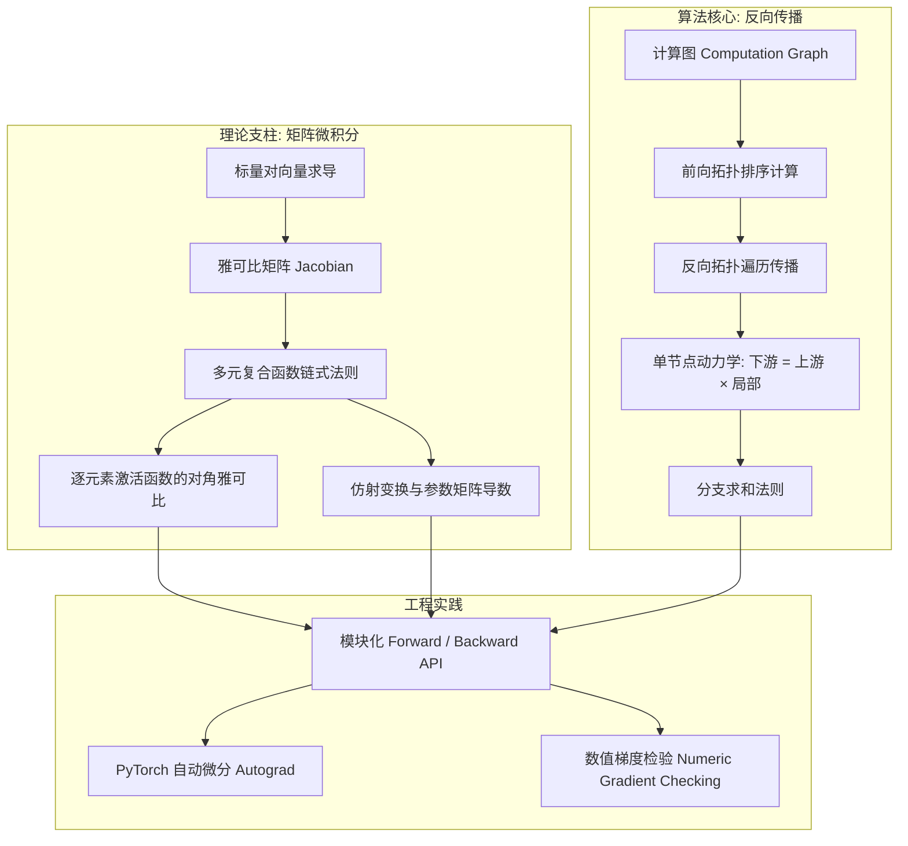

---

## 2. 神经网络层与上下文窗口分类回顾（NER 任务）

### 2.1 人工神经元模型演进

*(参考时间: 00:03:00)*


神经网络的构想最早源于对生物大脑神经元信号传递的数学抽象。
1. **McCulloch-Pitts 阈值单元 (1943)**：最早的二值神经元模型，采用阶跃函数：
   $$
   y = \mathbf{1}(w^T x - \theta) = \begin{cases} 1, & w^T x \ge \theta \\ 0, & w^T x < \theta \end{cases}
   $$
   阶跃函数的导数处处为 0（在不连续点处导数不存在），这意味着**无法基于梯度下降算法进行参数优化**。
2. **现代连续可微神经元**：引入连续非线性激活函数 $f(\cdot)$，将输入信号的线性组合映射到光滑曲面上：
   $$
   h = f(w^T x + b)
   $$
   这使得整个模型处处可导，从而为基于梯度的反向传播学习铺平了道路。

### 2.2 单层神经元的矩阵紧凑表达

*(参考时间: 00:04:15)*

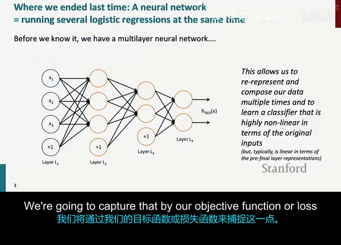

在实际工程中，单层网络通常包含多个并行的人工神经元。假设输入向量 $x \in \mathbb{R}^d$，隐藏层包含 $m$ 个神经元，第 $i$ 个神经元的输出为：
$$
a_i = f\left(\sum_{j=1}^d W_{ij} x_j + b_i\right)
$$

将所有神经元堆叠，即可得到优美简洁的矩阵表达形式：
$$
z = Wx + b \in \mathbb{R}^m
$$
$$
a = f(z) = [f(z_1), f(z_2), \dots, f(z_m)]^T \in \mathbb{R}^m
$$

其中：
- $W \in \mathbb{R}^{m \times d}$ 为权重矩阵（Weight Matrix），其第 $i$ 行 $W_{i,:}$ 对应第 $i$ 个神经元的输入权重向量；
- $b \in \mathbb{R}^m$ 为偏置向量（Bias Vector）；
- $z \in \mathbb{R}^m$ 称为净输入（Net Input）或预激活值（Pre-activation）；
- $a \in \mathbb{R}^m$ 为激活值向量（Activation Vector）；
- 激活函数 $f(\cdot)$ 作用于向量 $z$ 时采用**逐元素应用（Element-wise）**的约定。

### 2.3 命名实体识别（NER）上下文窗口分类实战架构

*(参考时间: 00:05:45)*

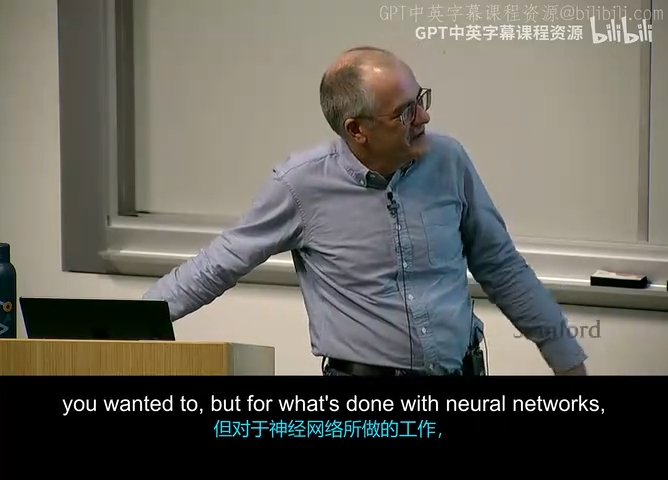

为了在自然语言处理中具体应用上述神经网络层，讲师以**命名实体识别（Named Entity Recognition, NER）**中的上下文窗口分类为例进行了详尽展示。

任务目标：判断上下文窗口中心位置的词是否为一个**地理位置实体（Location）**。例如对于句子：
> "... museums in **Paris** are amazing ..."

我们提取以 "Paris" 为中心的 5 词滑动窗口：
$$
\text{Window} = [\text{museums}, \text{in}, \text{Paris}, \text{are}, \text{amazing}]
$$

1. **向量拼接（Concatenation）**：从词表中查找这 5 个词的 $d$ 维稠密词向量，将它们沿行方向拼接成一个超长输入向量 $x$：
   $$
   x = [x_{\text{museums}}^T, x_{\text{in}}^T, x_{\text{Paris}}^T, x_{\text{are}}^T, x_{\text{amazing}}^T]^T \in \mathbb{R}^{5d}
   $$
2. **隐藏层特征交互**：
   $$
   z = Wx + b \in \mathbb{R}^m
   $$
   $$
   h = f(z) \in \mathbb{R}^m
   $$
   矩阵乘法 $Wx$ 的核心物理意义在于：它允许窗口中不同位置的词向量之间产生任意交叉乘积，从而捕捉复杂的上下文语境（例如 "museums in" 强烈暗示后面的词是一个地名）。
3. **输出未归一化打分与概率预测**：
   通过一个线性输出向量 $u \in \mathbb{R}^m$ 计算标量打分 $s \in \mathbb{R}$，再通过 Sigmoid 函数映射为二分类概率：
   $$
   s = u^T h \in \mathbb{R}
   $$
   $$
   P(\text{Location} \mid x) = \sigma(s) = \frac{1}{1 + e^{-s}}
   $$

### 2.4 非线性激活函数全景对比与几何特性

*(参考时间: 00:08:20)*

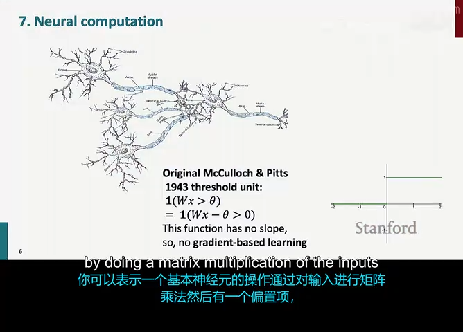

神经元中的激活函数 $f(z)$ 赋予了网络拟合复杂曲面的能力。讲师重点剖析了三大主流激活函数：

| 激活函数 | 数学表达式 | 输出值域 | 导数表达式 $f'(z)$ | 优点与工业界应用评价 | 缺陷与潜在病态 |
| :--- | :--- | :--- | :--- | :--- | :--- |
| **Sigmoid ($\sigma$)** | $\sigma(z) = \frac{1}{1+e^{-z}}$ | $(0, 1)$ | $\sigma(z)(1 - \sigma(z))$ | 输出天然具备概率解释，常用于二分类输出层。 | 最大导数仅为 $0.25$，深层网络反传时导致严重的**梯度消失**；输出非零中心化。 |
| **tanh** | $\tanh(z) = \frac{e^z - e^{-z}}{e^z + e^{-z}}$ | $(-1, 1)$ | $1 - \tanh^2(z)$ | 零均值中心化（Zero-centered）；本质是缩放平移的 Sigmoid：$\tanh(z) = 2\sigma(2z) - 1$。 | 饱和区导数依然趋近于 0，无法彻底解决深度网络中的梯度弥散。 |
| **ReLU** | $\text{ReLU}(z) = \max(0, z)$ | $[0, +\infty)$ | $\begin{cases} 1, & z > 0 \\ 0, & z \le 0 \end{cases}$ | **深度前馈网络的绝对首选**。计算极其廉价（仅做阈值判断）；正半轴导数恒为 1，彻底消除了正向饱和区的梯度消失。 | 负半轴导数为 0，一旦学习率过大导致权重落入全负区域，神经元将永久失去活性（Dead ReLU）。 |

### 2.5 为什么非线性不可或缺？（多层线性网络的数学退化）

*(参考时间: 00:13:50)*

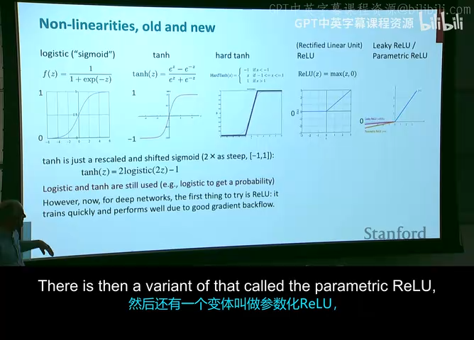

初学者常问：如果我们移除激活函数 $f$，仅堆叠多层全连接矩阵运算，网络是否能通过层数增加变得更强？

**数学证明：没有非线性的多层网络必然退化为单层线性回归。**
假设一个 3 层无激活函数的前馈网络：
$$
h_1 = W_1 x + b_1
$$
$$
h_2 = W_2 h_1 + b_2 = W_2 (W_1 x + b_1) + b_2 = (W_2 W_1) x + (W_2 b_1 + b_2)
$$
$$
y = W_3 h_2 + b_3 = W_3 [(W_2 W_1) x + (W_2 b_1 + b_2)] + b_3 = (W_3 W_2 W_1) x + (W_3 W_2 b_1 + W_3 b_2 + b_3)
$$

由于矩阵乘法满足结合律，令等效权重矩阵 $W_{\text{eff}} = W_3 W_2 W_1 \in \mathbb{R}^{c \times d}$，等效偏置向量 $b_{\text{eff}} = W_3 W_2 b_1 + W_3 b_2 + b_3 \in \mathbb{R}^c$，上式等价于：
$$
y = W_{\text{eff}} x + b_{\text{eff}}
$$
这证明无论网络堆叠多少层，其决策边界依然是一个超平面（Hyperplane），根本无法拟合诸如 XOR、同心圆或任何非线性语言特征。**非线性激活函数是赋予深度网络“表征重塑与曲面扭折能力”的唯一源泉。**

---

## 3. 矩阵微积分基础（Matrix Calculus & 雅可比矩阵）

*(参考时间: 00:18:25)*


在经典单变量微积分中，导数描述的是一个标量输入对一个标量输出的变化率。然而在深度学习中，网络的每一层都是由向量（Vector）和矩阵（Matrix）构成的。为了严谨、系统地推导网络参数的更新梯度，我们必须掌握**矩阵微积分（Matrix Calculus）**的基本语言。

### 3.1 梯度定义与行向量约定（Row Vector Convention）

设 $f: \mathbb{R}^n \to \mathbb{R}$ 是一个标量函数，其输入为列向量 $x = [x_1, x_2, \dots, x_n]^T \in \mathbb{R}^n$。
在斯坦福 CS224N 及应用数学的大多数严格推导中，遵循**分子布局（Numerator Layout）/ 行向量约定**：
标量关于列向量的偏导数定义为一个**行向量（Row Vector）**：
$$
\frac{\partial f}{\partial x} = \begin{bmatrix} \frac{\partial f}{\partial x_1} & \frac{\partial f}{\partial x_2} & \cdots & \frac{\partial f}{\partial x_n} \end{bmatrix} \in \mathbb{R}^{1 \times n}
$$

> **重要说明：行向量导数 vs 几何梯度向量 $\nabla_x f$**  
> 几何学与优化理论中的梯度符号 $\nabla_x f$ 通常约定为一个与 $x$ 同维度的**列向量**（$\nabla_x f \in \mathbb{R}^{n \times 1}$），两者互为转置关系：
> $$
> \nabla_x f = \left( \frac{\partial f}{\partial x} \right)^T
> $$
> 坚持将导数 $\frac{\partial f}{\partial x}$ 写作行向量的最大优势在于：**它使得多元微积分的链式法则能够完全保持与矩阵乘法完全一致的维度自洽性**。

### 3.2 雅可比矩阵（Jacobian Matrix）——多变量导数的一般形式

*(参考时间: 00:23:45)*

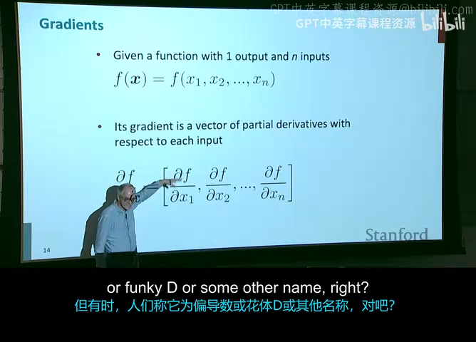

当一个函数的输入是 $n$ 维向量，输出是 $m$ 维向量时，即映射 $f: \mathbb{R}^n \to \mathbb{R}^m$：
$$
y = f(x) = \begin{bmatrix} f_1(x) \\ f_2(x) \\ \vdots \\ f_m(x) \end{bmatrix} \in \mathbb{R}^m
$$

其导数被称为**雅可比矩阵（Jacobian Matrix）** $J \in \mathbb{R}^{m \times n}$。雅可比矩阵的第 $i$ 行第 $j$ 列元素就是输出的第 $i$ 个分量对输入的第 $j$ 个分量的偏导数：
$$
J = \frac{\partial y}{\partial x} = \begin{bmatrix}
\frac{\partial y_1}{\partial x_1} & \frac{\partial y_1}{\partial x_2} & \cdots & \frac{\partial y_1}{\partial x_n} \\
\frac{\partial y_2}{\partial x_1} & \frac{\partial y_2}{\partial x_2} & \cdots & \frac{\partial y_2}{\partial x_n} \\
\vdots & \vdots & \ddots & \vdots \\
\frac{\partial y_m}{\partial x_1} & \frac{\partial y_m}{\partial x_2} & \cdots & \frac{\partial y_m}{\partial x_n}
\end{bmatrix} \in \mathbb{R}^{m \times n}
$$

- 雅可比矩阵的**行数**等于输出向量的维度 $m$；
- 雅可比矩阵的**列数**等于输入向量的维度 $n$；
- 特例：当输出为标量时（$m=1$），雅可比矩阵退化为 $1 \times n$ 的行向量导数；当输入为标量时（$n=1$），雅可比矩阵退化为 $m \times 1$ 的列向量导数。

### 3.3 复合函数的雅可比链式法则（The Chain Rule for Jacobians）

设 $x \in \mathbb{R}^n$，$y = g(x) \in \mathbb{R}^m$，$z = f(y) \in \mathbb{R}^p$。
则复合函数 $z = (f \circ g)(x)$ 关于自变量 $x$ 的导数，等于两个局部雅可比矩阵的标准矩阵乘积：
$$
\frac{\partial z}{\partial x} = \frac{\partial z}{\partial y} \frac{\partial y}{\partial x}
$$

**维度验证**：
$$
\underbrace{\frac{\partial z}{\partial x}}_{p \times n} = \underbrace{\frac{\partial z}{\partial y}}_{p \times m} \times \underbrace{\frac{\partial y}{\partial x}}_{m \times n}
$$
内部维度 $m$ 完美对齐消去，结果为 $p \times n$。这体现了行向量与雅可比矩阵约定的优越性——无需繁琐地记忆何时转置，直接依序进行矩阵连乘！

### 3.4 四大经典雅可比推导实战

为了手算神经网络，讲师在课堂上细致推演了四大常见算子的雅可比矩阵：

#### ① 逐元素激活函数（Element-wise Activation）的对角雅可比

*(参考时间: 00:27:10)*

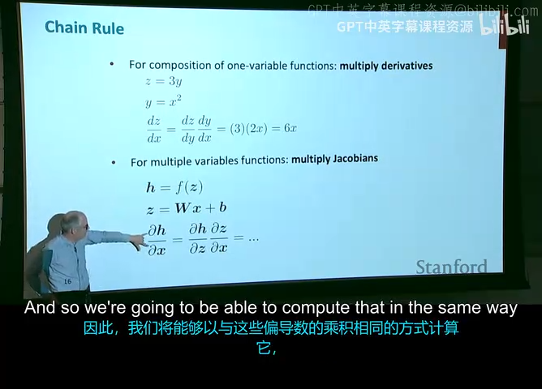

设输入向量 $z \in \mathbb{R}^n$，输出向量 $a = f(z) \in \mathbb{R}^n$，其中每个元素独立计算：$a_i = f(z_i)$。
考虑雅可比矩阵中的任一元素 $J_{ij} = \frac{\partial a_i}{\partial z_j}$：
- 当 $i = j$ 时，$\frac{\partial a_i}{\partial z_i} = f'(z_i)$；
- 当 $i \neq j$ 时，因为分量间互不影响，$\frac{\partial a_i}{\partial z_j} = 0$。

因此，逐元素激活函数的雅可比矩阵是一个**对角矩阵（Diagonal Matrix）**：
$$
\frac{\partial a}{\partial z} = \operatorname{diag}(f'(z)) = \begin{bmatrix}
f'(z_1) & 0 & \cdots & 0 \\
0 & f'(z_2) & \cdots & 0 \\
\vdots & \vdots & \ddots & \vdots \\
0 & 0 & \cdots & f'(z_n)
\end{bmatrix} \in \mathbb{R}^{n \times n}
$$

> **关键工程洞察**：在反向传播实现中，我们**绝对不会显式构造这个巨大的 $n \times n$ 对角矩阵**（若 $n=1024$，全矩阵包含上百万个无用的 0），而是将其与上游梯度的矩阵乘法退化为**阿达玛积（Hadamard Product, 逐元素相乘 $\circ$）**，时间复杂度从 $O(n^2)$ 骤降至 $O(n)$。

#### ② 线性变换关于输入的导数

设 $z = Wx + b \in \mathbb{R}^m$，其中 $W \in \mathbb{R}^{m \times n}$，$x \in \mathbb{R}^n$。
考察其第 $i$ 个分量：$z_i = \sum_{k=1}^n W_{ik} x_k + b_i$。
对输入的第 $j$ 个分量求偏导：
$$
\frac{\partial z_i}{\partial x_j} = W_{ij}
$$
因此，雅可比矩阵完全等于权重矩阵本身：
$$
\frac{\partial z}{\partial x} = W \in \mathbb{R}^{m \times n}
$$

#### ③ 线性变换关于偏置的导数

同上，对偏置的第 $j$ 个分量求偏导：
$$
\frac{\partial z_i}{\partial b_j} = \begin{cases} 1, & i = j \\ 0, & i \neq j \end{cases}
$$
因此，雅可比矩阵为单位矩阵（Identity Matrix）：
$$
\frac{\partial z}{\partial b} = I_m \in \mathbb{R}^{m \times m}
$$

#### ④ 标量内积关于向量的导数

设打分标量 $s = u^T h \in \mathbb{R}$，其中 $u, h \in \mathbb{R}^m$。即 $s = \sum_{i=1}^m u_i h_i$。
根据行向量导数约定：
$$
\frac{\partial s}{\partial h} = \begin{bmatrix} \frac{\partial s}{\partial h_1} & \frac{\partial s}{\partial h_2} & \cdots & \frac{\partial s}{\partial h_m} \end{bmatrix} = \begin{bmatrix} u_1 & u_2 & \cdots & u_m \end{bmatrix} = u^T \in \mathbb{R}^{1 \times m}
$$
同理，关于 $u$ 的导数为：
$$
\frac{\partial s}{\partial u} = h^T \in \mathbb{R}^{1 \times m}
$$

---

## 4. 单隐藏层神经网络的反向梯度手工推导

*(参考时间: 00:32:45)*

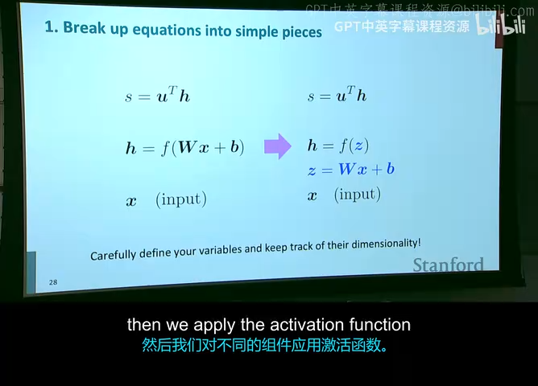

现在，我们将上述原子雅可比矩阵拼接起来，对完整的单隐藏层分类网络进行端到端的手工梯度推导。
网络前向计算全过程如下：
$$
z = Wx + b \in \mathbb{R}^m
$$
$$
h = f(z) \in \mathbb{R}^m
$$
$$
s = u^T h \in \mathbb{R}
$$

目标是求解损失标量关于网络所有参数（偏置 $b$、权重矩阵 $W$ 以及输入向量 $x$）的梯度。

### 4.1 偏置梯度 $\frac{\partial s}{\partial b}$ 与误差向量 $\delta$

应用雅可比链式法则，标量 $s$ 关于偏置向量 $b$ 的导数可展开为：
$$
\frac{\partial s}{\partial b} = \underbrace{\frac{\partial s}{\partial h}}_{1 \times m} \times \underbrace{\frac{\partial h}{\partial z}}_{m \times m} \times \underbrace{\frac{\partial z}{\partial b}}_{m \times m}
$$

代入上一节推导的三个原子雅可比矩阵：
$$
\frac{\partial s}{\partial b} = u^T \times \operatorname{diag}(f'(z)) \times I_m = u^T \operatorname{diag}(f'(z)) \in \mathbb{R}^{1 \times m}
$$

由于 $u^T$ 是行向量，乘以对角矩阵 $\operatorname{diag}(f'(z))$ 相当于将向量 $u$ 与向量 $f'(z)$ 进行**逐元素乘积**：
$$
\frac{\partial s}{\partial b} = [u_1 f'(z_1), u_2 f'(z_2), \dots, u_m f'(z_m)] \in \mathbb{R}^{1 \times m}
$$

*(参考时间: 00:36:50)*

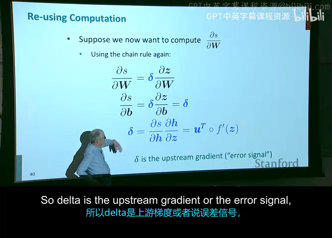

#### 核心概念：定义误差信号向量 $\delta$（Local Error Signal）
观察上式，项 $u^T \operatorname{diag}(f'(z))$ 是整个反向传播链条的关键中继站。它代表的是**输出打分 $s$ 对净输入向量 $z$ 的导数**：
$$
\delta \equiv \frac{\partial s}{\partial z} = \frac{\partial s}{\partial h} \frac{\partial h}{\partial z} = u^T \operatorname{diag}(f'(z)) = u^T \circ f'(z)^T \in \mathbb{R}^{1 \times m}
$$

或者写成对应的列向量形式：
$$
\delta^T = u \circ f'(z) \in \mathbb{R}^{m \times 1}
$$

在神经网络文献中，$\delta$ 被称为神经元层的**局部误差信号（Error Signal）**。它的物理意义非常直观：
- $u$ 是来自上游（后一层）传递回来的梯度信号；
- $f'(z)$ 是当前层的局部激活响应（Local Gradient）；
- 误差信号 $\delta$ 正是**上游反传梯度与当前层局部梯度的逐元素乘积**。引入 $\delta$ 极大地避免了在求取其他参数梯度时的重复计算！

### 4.2 权重矩阵梯度 $\frac{\partial s}{\partial W}$（矩阵导数与外积直觉）

*(参考时间: 00:41:30)*

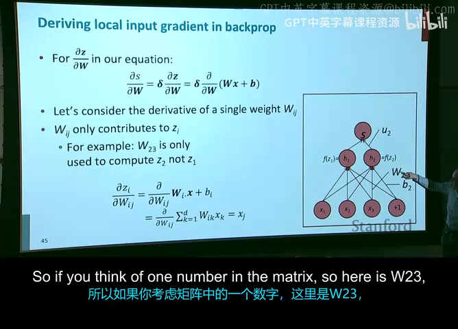

求解 $\frac{\partial s}{\partial W}$ 时，许多初学者会感到困惑：$s$ 是标量，而 $W$ 是一个 $m \times d$ 的矩阵。
根据**输出形状约定（Output Shape Convention）**：
> **原则**：目标标量关于参数矩阵的梯度，其维度必须与参数矩阵本身的维度完全一致！
> $$
> W \in \mathbb{R}^{m \times d} \implies \frac{\partial s}{\partial W} \in \mathbb{R}^{m \times d}
> $$

#### 严格的标量逐元素求导法（Element-wise Proof）
为了彻底消除对维度转置的猜测，讲师 Manning 推荐最严谨的做法：**直接对矩阵的单元素 $W_{ij}$ 求导**。
回顾 $z_i = \sum_{k=1}^d W_{ik} x_k + b_i$。显然，$W_{ij}$ 只直接影响 $z_i$，对其他分量 $z_k (k \neq i)$ 没有影响。
根据链式法则：
$$
\frac{\partial s}{\partial W_{ij}} = \sum_{k=1}^m \frac{\partial s}{\partial z_k} \frac{\partial z_k}{\partial W_{ij}} = \frac{\partial s}{\partial z_i} \frac{\partial z_i}{\partial W_{ij}}
$$
已知：
- $\frac{\partial s}{\partial z_i} = \delta_i$（即误差向量的第 $i$ 个分量）；
- $\frac{\partial z_i}{\partial W_{ij}} = \frac{\partial}{\partial W_{ij}} \left( \sum_{k=1}^d W_{ik} x_k + b_i \right) = x_j$。

代入得：
$$
\frac{\partial s}{\partial W_{ij}} = \delta_i x_j
$$

#### 向量化外积表达（Outer Product）
所有 $m \times d$ 个元素的偏导数构成矩阵：
$$
\frac{\partial s}{\partial W} = \begin{bmatrix}
\delta_1 x_1 & \delta_1 x_2 & \cdots & \delta_1 x_d \\
\delta_2 x_1 & \delta_2 x_2 & \cdots & \delta_2 x_d \\
\vdots & \vdots & \ddots & \vdots \\
\delta_m x_1 & \delta_m x_2 & \cdots & \delta_m x_d
\end{bmatrix} = \begin{bmatrix} \delta_1 \\ \delta_2 \\ \vdots \\ \delta_m \end{bmatrix} \begin{bmatrix} x_1 & x_2 & \cdots & x_d \end{bmatrix} = \delta^T x^T \in \mathbb{R}^{m \times d}
$$

> **结论**：权重矩阵的梯度等于**该层误差列向量 $\delta^T$ 与输入行向量 $x^T$ 的外积（Outer Product）**！
> - 若使用行向量 $\delta \in \mathbb{R}^{1 \times m}$，则梯度写为 $\delta^T x^T$（维度 $(m \times 1) \times (1 \times d) = m \times d$）；
> - 若使用列向量定义 $\delta_{\text{col}} \in \mathbb{R}^{m \times 1}$，则写为 $\delta_{\text{col}} x^T$。

### 4.3 跨层传递：对输入向量的局部梯度 $\frac{\partial s}{\partial x}$

*(参考时间: 00:45:50)*

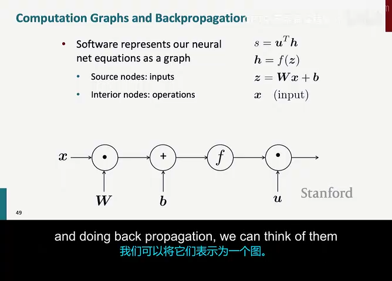

如果该层下面还有更深的隐藏层，或者我们需要更新词向量（Word Embeddings），就必须计算损失对输入 $x$ 的导数：
$$
\frac{\partial s}{\partial x} = \underbrace{\frac{\partial s}{\partial z}}_{1 \times m} \times \underbrace{\frac{\partial z}{\partial x}}_{m \times d} = \delta W \in \mathbb{R}^{1 \times d}
$$

若以列向量梯度形式表示：
$$
\nabla_x s = \left( \frac{\partial s}{\partial x} \right)^T = (\delta W)^T = W^T \delta^T \in \mathbb{R}^{d \times 1}
$$

**物理直觉**：
- 在前向传播中，特征通过权重矩阵 $W$ 从下往上流动：$z = Wx$；
- 在反向传播中，误差信号通过转置矩阵 $W^T$ 从上往下反传：$\nabla_x s = W^T \delta^T$。
这展示了深层网络各层之间对称而优美的对偶性！

---

## 5. 计算图与反向传播算法（Computation Graphs & Backpropagation）

### 5.1 为什么需要计算图？

*(参考时间: 00:48:45)*

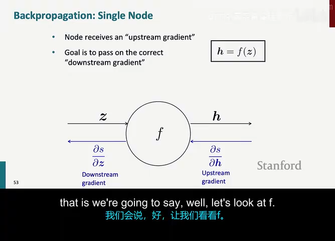

在前一节中，我们通过代数展开手动推导了单层神经网络的导数。然而，现代大语言模型（如 GPT-4、LLaMA）包含数千个计算层和数十亿甚至万亿参数。如果对每个新架构都通过纸笔手算代数展开，既容易出错，又无法工程自动化。

**计算图（Computation Graph）**提供了一种通用的数据结构抽象：
- **节点（Nodes）**：代表输入变量、可学习参数或基本数学运算（如加法、乘法、$\max$、$\exp$、$\sin$ 等）；
- **有向边（Directed Edges）**：代表张量数据在运算之间的传递与依赖关系。

通过将任意前向计算表达为有向无环图（DAG），求导问题被转化为图遍历算法——**反向传播正是链式法则在有向无环图上的高效动态规划实现**。

### 5.2 反向传播的单节点核心动力学

*(参考时间: 00:53:20)*

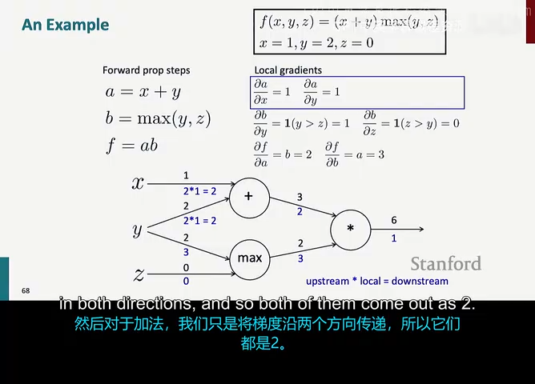

考虑计算图中的一个任意算子节点 $f$。它接收输入 $x$ 和 $y$，产生输出 $z = f(x, y)$。同时，该节点的输出 $z$ 会继续向后传递，最终影响整个网络的最终标量损失 $L$。

在反向传播过程中，该节点遵循一条简洁而通用的黄金法则：
$$
\text{下游梯度（Downstream Gradient）} = \text{上游梯度（Upstream Gradient）} \times \text{局部梯度（Local Gradient）}
$$

具体公式如下：
1. **上游梯度**：由上一层传递回来的标量偏导数 $\frac{\partial L}{\partial z}$；
2. **局部梯度**：当前节点算子关于其各个输入的局部偏导数 $\frac{\partial z}{\partial x}$ 与 $\frac{\partial z}{\partial y}$（在前向传播计算 $z$ 时即可同步求出）；
3. **计算向下游输出的梯度**：
   $$
   \frac{\partial L}{\partial x} = \frac{\partial L}{\partial z} \cdot \frac{\partial z}{\partial x}
   $$
   $$
   \frac{\partial L}{\partial y} = \frac{\partial L}{\partial z} \cdot \frac{\partial z}{\partial y}
   $$

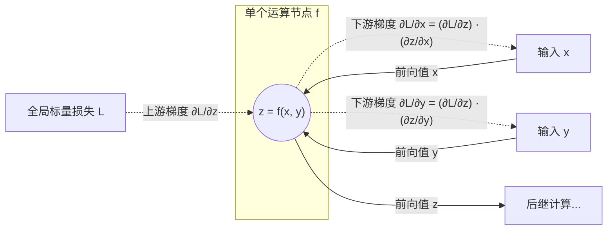

每个节点只需关心自身的局部导数，并与上游传来的梯度信号相乘，完全无需知晓网络其余数千个节点的内部细节。这种**局部模块化解耦**是现代深度学习框架能够灵活组合任意模型架构的基石。

### 5.3 经典手算实战全流程：$f(x,y,z) = (x+y)\max(y,z)$

*(参考时间: 00:55:30)*

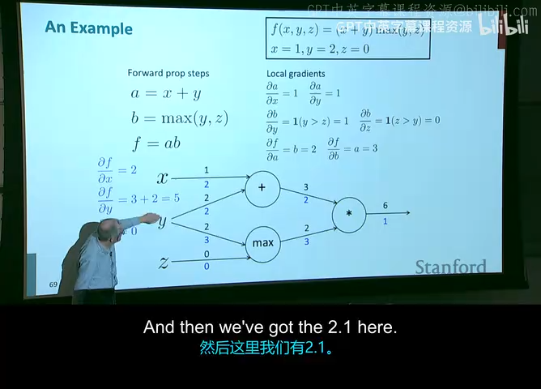

为了将抽象公式转化为直观感受，讲师在黑板上逐步演示了一个极具代表性的数值算例：
函数定义为：
$$
f(x, y, z) = (x + y) \max(y, z)
$$
给定初始数值：$x = 1, y = 2, z = 0$。

#### 步骤 1：构建计算图并进行前向传播（Forward Pass）
引入中间变量：
1. 加法门：$a = x + y$
   - 代入数值：$a = 1 + 2 = 3$
2. 最大值门：$b = \max(y, z)$
   - 代入数值：$b = \max(2, 0) = 2$
3. 乘法门：$f = a \cdot b$
   - 代入数值：$f = 3 \cdot 2 = 6$

前向传播完成，网络最终输出标量 $f = 6$。

#### 步骤 2：启动反向传播（Backward Pass）
从图的最末端节点开始反向遍历：
1. **终点根节点**：
   $$
   \frac{\partial f}{\partial f} = 1
   $$
2. **乘法节点 $f = a \cdot b$**：
   - 上游梯度：$\frac{\partial f}{\partial f} = 1$
   - 局部梯度：$\frac{\partial f}{\partial a} = b = 2$，$\frac{\partial f}{\partial b} = a = 3$
   - 下传下游梯度：
     $$
     \frac{\partial f}{\partial a} = 1 \times 2 = 2
     $$
     $$
     \frac{\partial f}{\partial b} = 1 \times 3 = 3
     $$
3. **加法节点 $a = x + y$**：
   - 接收上游梯度：$\frac{\partial f}{\partial a} = 2$
   - 局部梯度：$\frac{\partial a}{\partial x} = 1$，$\frac{\partial a}{\partial y} = 1$
   - 下传下游梯度：
     $$
     \frac{\partial f}{\partial x} = 2 \times 1 = 2
     $$
     （对于变量 $y$，此路径贡献为 $2 \times 1 = 2$）
4. **最大值节点 $b = \max(y, z)$**：
   - 接收上游梯度：$\frac{\partial f}{\partial b} = 3$
   - 因为当前 $y = 2 > z = 0$，最大值取自 $y$：
     $$
     \frac{\partial b}{\partial y} = 1, \quad \frac{\partial b}{\partial z} = 0
     $$
   - 下传下游梯度：
     $$
     \frac{\partial f}{\partial z} = 3 \times 0 = 0
     $$
     （对于变量 $y$，此路径贡献为 $3 \times 1 = 3$）

### 5.4 分支求和法则（Branch Summing Rule）

*(参考时间: 00:58:20)*

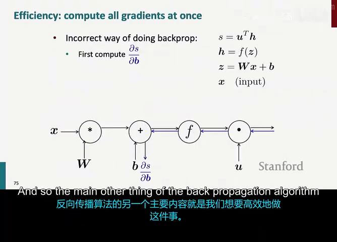

在上述算例中，注意到变量 $y$ 同时连接到了两个后继节点（加法节点 $a$ 与最大值节点 $b$）。
根据多元微积分的全微分链式法则：当一个变量沿多个分支影响最终结果时，**其总梯度等于所有分支传回梯度的代数累加**：
$$
\frac{\partial f}{\partial y} = \sum_{i \in \text{children}(y)} \frac{\partial f}{\partial q_i} \frac{\partial q_i}{\partial y}
$$

在本例中，$y$ 的两个分支为 $a$ 和 $b$：
$$
\frac{\partial f}{\partial y} = \frac{\partial f}{\partial a} \frac{\partial a}{\partial y} + \frac{\partial f}{\partial b} \frac{\partial b}{\partial y} = (2 \times 1) + (3 \times 1) = 2 + 3 = 5
$$

**总结最终所有自变量的梯度**：
$$
\nabla_{[x, y, z]} f = \left[ \frac{\partial f}{\partial x}, \frac{\partial f}{\partial y}, \frac{\partial f}{\partial z} \right] = [2, 5, 0]
$$

数值直觉验证：
若将 $y$ 增加一极小量 $\Delta = 0.001$（$y = 2.001$）：
$$
a' = 1 + 2.001 = 3.001, \quad b' = \max(2.001, 0) = 2.001
$$
$$
f' = 3.001 \times 2.001 = 6.005001 \approx 6 + 5 \times 0.001
$$
变化量确实为 $5 \Delta$，与我们反向传播求得的梯度 5 完全一致！

---

## 6. 经典计算门（Gates）的直觉与物理意义

*(参考时间: 01:03:15)*

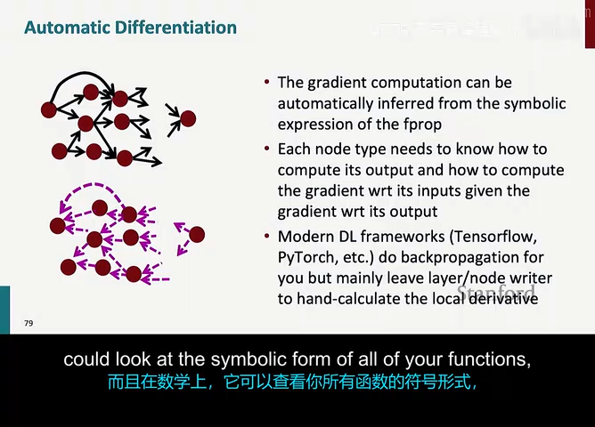

将反向传播的动力学映射到各种基础运算节点上，能够建立起极具启发性的物理直觉：

### 6.1 加法门（Addition Gate）：梯度的“广播分发器”（Gradient Distributor）
- **前向行为**：$z = x + y$
- **局部梯度**：$\frac{\partial z}{\partial x} = 1, \frac{\partial z}{\partial y} = 1$
- **反向行为**：$\frac{\partial L}{\partial x} = \frac{\partial L}{\partial z}, \frac{\partial L}{\partial y} = \frac{\partial L}{\partial z}$
- **直觉**：加法门将上游的梯度**一模一样、不增不减地广播复制分发**给所有输入端。正因如此，ResNet 中的残差连接（Residual Connection: $x + F(x)$）能够让深层梯度无衰减地直接“抄近道”流回浅层，彻底攻克了深层网络的训练难题。

### 6.2 乘法门（Multiplication Gate）：梯度的“交换缩放器”（Gradient Switcher & Scaler）
- **前向行为**：$z = x \cdot y$
- **局部梯度**：$\frac{\partial z}{\partial x} = y, \frac{\partial z}{\partial y} = x$
- **反向行为**：$\frac{\partial L}{\partial x} = \frac{\partial L}{\partial z} \cdot y, \frac{\partial L}{\partial y} = \frac{\partial L}{\partial z} \cdot x$
- **直觉**：乘法门会**将另一个输入的数值作为自身的缩放系数**。如果其中一个输入数值极大，另一个输入的梯度就会被剧烈放大；反之，如果某个输入接近于 0，另一侧的梯度就会被完全抹杀。在全连接层 $Wx$ 中，如果输入特征 $x$ 未经归一化而数值极大，将导致权重梯度 $\delta^T x^T$ 产生剧烈震荡，这也是为什么 Batch Normalization 和 Layer Normalization 对稳定训练至关重要。

### 6.3 最大值门（Max Gate）：梯度的“路由器”（Gradient Router）
- **前向行为**：$z = \max(x, y)$
- **局部梯度**：前向传播中数值较大的输入端局部导数为 1，较小的为 0。
- **反向行为**：上游的梯度会被**全额路由发送给前向获胜的输入端**，而落败的输入端梯度为严格的 0。这正是 ReLU 和 Max Pooling 层的核心传导机制。

---

## 7. 反向传播的工程实现与自动微分（Autograd）

### 7.1 算法效率与前向缓存（Forward Cache）

*(参考时间: 01:07:30)*

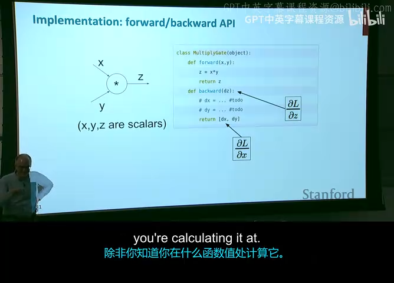

从算法复杂度来看，计算图上的反向传播展现了惊人的计算优势：
1. **时间复杂度**：
   - 设计算图的有向边集合大小为 $|E|$；
   - 前向传播访问所有节点一次，耗时 $O(|E|)$；
   - 反向传播按拓扑逆序（Reverse Topological Order）回溯图中的每一条边，计算局部梯度与向量乘法，耗时同样为 $O(|E|)$。
   - **总体计算代价通常仅为前向传播的 2 到 3 倍**。这比任何朴素的数值求导（需要对每个参数重新执行一次前向）快了数百万倍！
2. **空间代价与显存瓶颈（The Memory Cost of Training）**：
   - 反向传播计算局部梯度时，必须用到前向传播所计算出的中间激活值（例如：$f'(z)$ 需要中间激活 $z$；权重梯度 $\delta^T x^T$ 需要中间输入 $x$）。
   - 因此，在前向传播执行期间，**所有中间节点的激活张量必须常驻显存（Cached Activations）**，直到该节点的反向梯度计算完成才能释放。
   - 这也是为什么深度神经网络**训练时所需的显存远大于推理（Inference）显存**的核心根本原因！

### 7.2 模块化 Forward / Backward API 设计原理

*(参考时间: 01:10:45)*

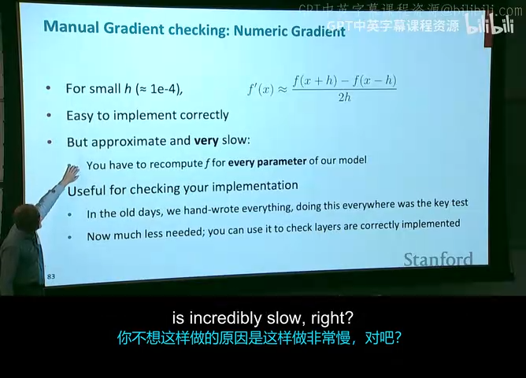

现代深度学习框架（PyTorch、JAX 等）并不是把整个网络作为一个不可分割的巨型公式来求导，而是将每个算子抽象为一个继承基类的独立模块（如 PyTorch 的 `torch.autograd.Function`）：

每个算子必须成对实现两个方法：
```python
class LinearLayerFunction:
    @staticmethod
    def forward(ctx, x, W, b):
        """
        前向传播：计算 z = Wx + b
        ctx: 上下文对象，用于缓存反向传播所需的中间张量
        """
        ctx.save_for_backward(x, W, b)
        z = np.matmul(W, x) + b
        return z

    @staticmethod
    def backward(ctx, grad_output):
        """
        反向传播：接收上游传来的梯度 delta = grad_output (形状 1 x m)
        返回关于输入 x, W, b 的下游梯度
        """
        x, W, b = ctx.saved_tensors
        
        # 1. 对偏置 b 的梯度
        grad_b = grad_output.copy()
        
        # 2. 对权重 W 的梯度: 外积 delta^T * x^T
        grad_W = np.outer(grad_output, x)
        
        # 3. 对输入 x 的下游梯度: delta * W
        grad_x = np.matmul(grad_output, W)
        
        return grad_x, grad_W, grad_b
```

这种模块化设计使得研究者可以随意自由搭积木，任何复杂的深度模型只要由可微的子模块组合而成，系统便能沿着计算图自动完成整网的反向传播。

### 7.3 数值梯度检验（Numerical Gradient Checking）

在手写反向传播或自定义底层算子 CUDA 核心时，代码中容易出现维度转置错误、符号遗漏或下标偏差。为了验证解析梯度（Analytic Gradient）的正确性，必须采用**数值梯度检验（Gradient Checking）**。

依据导数的双边有限差分定义（Two-sided Difference）：
$$
\frac{\partial f}{\partial \theta_i} \approx \frac{f(\theta + \epsilon \cdot e_i) - f(\theta - \epsilon \cdot e_i)}{2\epsilon}
$$

其中 $\epsilon$ 取一个极小量（如 $10^{-4}$ 或 $10^{-6}$），$e_i$ 为第 $i$ 个维度的单位基向量。双边差分的逼近误差为 $O(\epsilon^2)$，远优于单边差分的 $O(\epsilon)$。

**检验指标（相对误差 Relative Error）**：
$$
\text{Relative Error} = \frac{\| \nabla_{\text{num}} - \nabla_{\text{analytic}} \|_2}{\| \nabla_{\text{num}} \|_2 + \| \nabla_{\text{analytic}} \|_2}
$$
- 若误差 $< 10^{-7}$：说明反向梯度推导与实现完全正确；
- 若误差在 $10^{-4} \sim 10^{-7}$ 之间：需仔细复查是否使用了不可微算子（如拐点处的 ReLU）；
- 若误差 $> 10^{-2}$：代码中必然存在重大推导或维度转置 Bug！

---

## 8. 核心要点总结与反向传播调试建议

### 8.1 核心概念对照与知识矩阵

| 概念/算子 | 核心数学公式 | 前向数据流 | 反向梯度动力学 | 常见工业界陷阱 |
| :--- | :--- | :--- | :--- | :--- |
| **全连接层** | $z = Wx + b$ | 矩阵乘法 + 偏置相加 | $\nabla_W = \delta^T x^T$, $\nabla_b = \delta$, $\nabla_x = \delta W$ | 输入未归一化导致 $\nabla_W$ 剧烈震荡 |
| **逐元素激活** | $a = f(z)$ | 逐分量非线性映射 | 误差逐元素相乘 $\delta = \text{upstream} \circ f'(z)$ | 饱和区导数趋零引发梯度消失 |
| **加法门** | $z = x + y$ | 信号直接求和 | 原样广播复制梯度 | 忘记对共享分支累加梯度 |
| **乘法门** | $z = x \cdot y$ | 交叉调制信号 | 交换输入作为缩放倍率 | 大数值导致梯度爆炸 |
| **最大值门** | $z = \max(x, y)$ | 阈值硬选择 | 梯度全额路由至胜出者，败者为 0 | 拐点处不可微；死神经元 |

### 8.2 工业界深度学习常见梯度病态与诊断指南

1. **梯度消失（Vanishing Gradients）**：
   - *病理表现*：深层网络浅层参数的梯度范数衰减至 $10^{-8}$ 以下，浅层权重几乎不更新。
   - *根源*：在深层网络中多次连乘最大导数 $< 1$ 的激活函数（如 Sigmoid 的 $0.25$）。
   - *解法*：替换为 ReLU / GELU 激活函数；引入残差连接（ResNet）；采用合理的权重初始化（He 初始化 / Xavier 初始化）。
2. **梯度爆炸（Exploding Gradients）**：
   - *病理表现*：损失函数突然变为 `NaN` 或 `Inf`，模型权重迅速发散。
   - *根源*：深层网络中权重矩阵范数过大，导致反向连乘 $W^T$ 时产生指数级发散。
   - *解法*：梯度裁剪（Gradient Clipping，限制梯度最大范数）；采用 LayerNorm / RMSNorm；降低学习率。
3. **死神经元现象（Dead ReLU Problem）**：
   - *病理表现*：部分神经元对于所有训练样本的输出恒为 0，反向梯度也恒为 0，永久丧失更新能力。
   - *根源*：过大的学习率导致偏置 $b$ 被更新为很大的负数，使得 $Wx + b$ 永远处于负半轴。
   - *解法*：采用 Leaky ReLU / PReLU / GELU；改用 Adam 等自适应学习率优化器；减小初始化偏置。

---

## 9. 附：官方参考与延伸阅读

1. **官方课程课件与讲义**：
   - [Stanford CS224N 2024 Winter 官方主页](https://web.stanford.edu/class/cs224n/)
   - [Lecture 3 官方幻灯片 (Slides PDF)](course/slides.pdf)
   - [Lecture 3 官方讲义 (Lecture Notes 03 PDF)](course/notes.pdf)
2. **经典微积分与反向传播奠基论文**：
   - Rumelhart, D. E., Hinton, G. E., & Williams, R. J. (1986). *Learning representations by back-propagating errors*. Nature, 323(6088), 533-536.
   - Goodfellow, I., Bengio, Y., & Courville, A. (2016). *Deep Learning* (Chapter 6: Deep Feedforward Networks). MIT Press.
3. **实战代码与工具库**：
   - PyTorch 自动求导机制解析：[`torch.autograd`](https://pytorch.org/docs/stable/autograd.html)
   - CS231n 经典计算图可视化教程：*Calculus on Computational Graphs: Backpropagation*

---

*本电子书由 [videobook](https://github.com/Luke-Evan/videobook) 流水线生成。课程讲义与幻灯片版权归讲师所有，依 [CC BY-NC 4.0](http://creativecommons.org/licenses/by-nc/4.0/) 发布。*
