# 斯坦福 CS224N 深度学习自然语言处理 | 第四讲：句法结构与依存句法分析（从传统转移系统到神经依存模型）

> **课程名称**：Stanford CS224N: Natural Language Processing with Deep Learning (Winter 2024)  
> **主讲人**：Prof. Christopher Manning (斯坦福大学)  
> **参考教材**：Lecture 4 Official Slides & Lecture Notes (Syntactic Structure and Dependency Parsing)  
> **视频溯源**：[Bilibili BV1U5RNYgEfp (Part 4)](https://www.bilibili.com/video/BV1U5RNYgEfp/?p=4)  
> **版权说明**：课程原版讲义、幻灯片与视频版权归斯坦福大学及主讲教师所有，遵循 CC BY-NC 许可协议。

## 目录

1. [课程导言与全景架构](#1)
2. [自然语言的歧义性与句法解析难题](#2)
3. [依存文法与依存树理论基础](#3)
4. [基于转移的依存句法分析（Transition-Based Parsing）](#4-transition-based-parsing)
5. [依存句法分析的客观评测范式（UAS 与 LAS）](#5-uas-las)
6. [神经依存句法分析模型（Chen & Manning 2014 经典架构）](#6-chen-manning-2014)
7. [基于图的依存句法分析（Graph-Based Parsing）与前沿演进](#7-graph-based-parsing)
8. [核心要点总结与技术对比矩阵](#8)
9. [附：官方参考与延伸阅读](#9)

---

## 1. 课程导言与全景架构

*(参考时间: 00:00:25)*

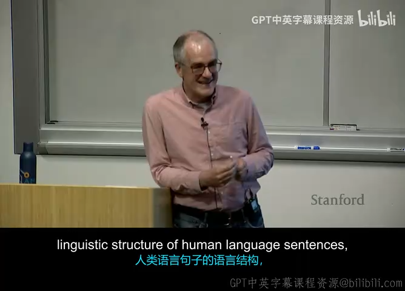

在前面三讲中，我们系统学习了词向量分布式表征（Word2Vec、GloVe）以及多层神经网络与反向传播算法的数学动力学。然而，人类语言绝非仅仅是词向量的简单线性排列或“词袋（Bag of Words）”。语言的本质在于**递归与层级组合（Compositionality）**：单词组合成短语，短语组合成从句，从句最终组合成表达复杂思想的完整句子。

为了让计算机真正理解语言中“谁对谁做了什么”（即施事者、动作、受事者与修饰关系），我们必须赋予模型解析**句法结构（Syntactic Structure）**的能力。

*(参考时间: 00:02:15)*

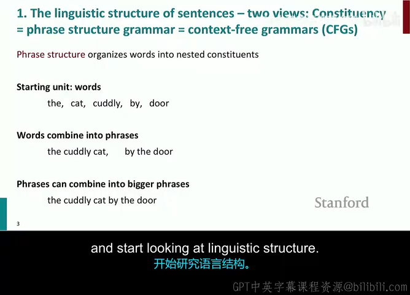

### 句法结构的两大经典视角：短语结构文法 vs 依存文法

*(参考时间: 00:03:45)*

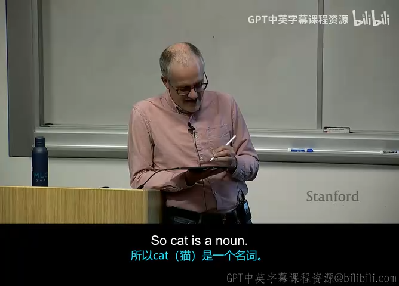

在计算语言学和自然语言处理的历史长河中，存在两种观察句子结构的根本范式：

1. **短语结构文法（Constituency Grammar / Context-Free Grammar, CFG）**：
   - **理论渊源**：源自诺姆·乔姆斯基（Noam Chomsky）的形式语言与短语结构理论。
   - **核心思想**：认为句子是由嵌套的“词组/成分（Constituents）”逐级合成的。例如：词汇组合为名词短语（NP）与动词短语（VP），再由 $S \to NP + VP$ 构成句子。
   - **表现形式**：多叉树结构，树的叶子节点是词汇，而内部所有非叶节点均是抽象语法范畴（如 $S, NP, VP, PP, D, N$ 等）。

2. **依存文法（Dependency Grammar）**：
   - **理论渊源**：可以追溯至两千五百年前古印度文法学家波你尼（Pāṇini），并由法国语言学家 Lucien Tesnière 在 1959 年系统现代化。
   - **核心思想**：语言结构直接体现为**词与词之间的二元修饰关联（Binary Asymmetric Relations）**。在一个句子中，某个核心词（支配词 Head / Governor）支配着修饰它的从属词（从属词 Dependent / Modifier）。
   - **表现形式**：有向有标记树图，树上的每一个节点都**严格对应句子中的一个真实词汇**，边代表具体的句法依赖关系（如主语 `nsubj`、宾语 `dobj`、定语 `amod` 等）。

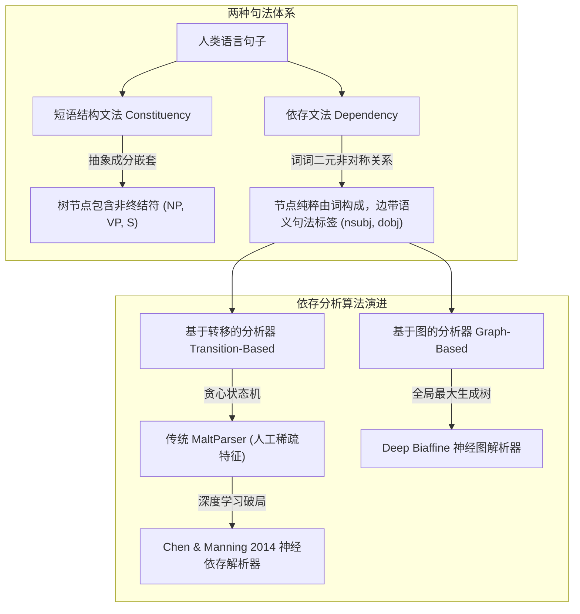

---

## 2. 自然语言的歧义性与句法解析难题

人类大脑处理母语时往往对句法结构的构建是潜意识且瞬间完成的，但对计算机而言，自然语言充满了海量的**结构歧义性（Structural Ambiguity）**。讲师 Manning 教授通过多个经典例句，生动剖析了自然语言理解的核心障碍。

### 2.1 介词短语依附歧义（Prepositional Phrase Attachment Ambiguity）

*(参考时间: 00:06:20)*

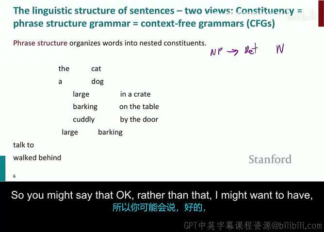

新闻报纸头条中经常出现引人发笑或令人困惑的标题，例如：
> **"San Jose cops kill man with knife."**（圣何塞警察杀死持刀男子 / 警察用刀杀死了男子）

介词短语 *"with knife"* 存在两种完全合法的句法依附方式（Attachment）：
- **依附于动词 kill**：修饰杀人所使用的工具，语义变为“警察用刀刺杀了男子”；
- **依附于名词 man**：作为定语修饰男子，语义变为“警察击毙了一名手持刀具的男子”。

*(参考时间: 00:16:15)*

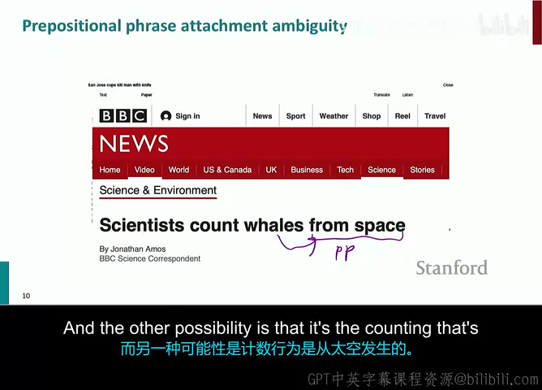

再看另一个经典科学报道头条：
> **"Scientists count whales from space."**（科学家从太空卫星计数鲸鱼 / 科学家数来自太空的鲸鱼）

介词短语 *"from space"* 同样存在双重依附可能：
- 依附于动词 *count*：科学家利用卫星轨道图像从太空中遥感统计地球上的鲸鱼（正确常识语义）；
- 依附于名词 *whales*：修饰鲸鱼来源，变成了“来自外太空的鲸鱼（Space Whales）”！

计算机缺乏物理世界常识，在纯文法推导下，这两种结构在概率上难解难分。

### 2.2 依附歧义的组合爆炸与卡塔兰数（Catalan Numbers）

*(参考时间: 00:18:30)*

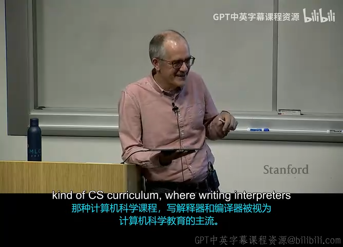

当一个句子中连续出现多个介词短语时，可能的句法解析树数量将呈**指数级爆炸**：
> "The board approves **[PP1 with caveats] [PP2 in an executive meeting] [PP3 on Tuesday] [PP4 for future investments]**..."

如果有 $n$ 个介词短语依次排布，句法解析树的可能组合数量严格对应组合数学中的**卡塔兰数（Catalan Numbers, $C_n$）**：
$$
C_n = \frac{1}{n+1} \binom{2n}{n} = \frac{(2n)!}{(n+1)! n!}
$$

随着 $n$ 的增加，解析树数量的增长速度极其骇人：
- $n = 1 \implies C_1 = 1$
- $n = 2 \implies C_2 = 2$
- $n = 3 \implies C_3 = 5$
- $n = 4 \implies C_4 = 14$
- $n = 5 \implies C_5 = 42$
- $n = 10 \implies C_{10} = 16,796$

这意味着仅仅包含几个介词修饰的普通复杂长句，候选句法树就高达数万甚至数百万种。完全依靠暴力穷举不仅无法运行，更无法选出合乎人类常理的最优解。

### 2.3 其他常见句法歧义类型

*(参考时间: 00:22:45)*

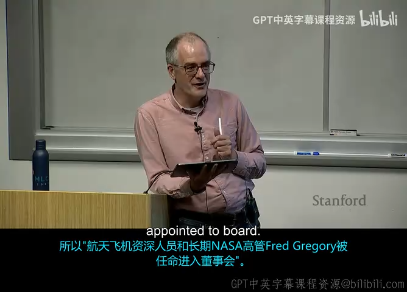

除了介词短语依附外，讲师还列举了以下几类高频歧义：

1. **并列连词范围歧义（Coordination Scope Ambiguity）**：
   - 例子：*"Shuttle veteran and longtime NASA executive Fred Gregory was appointed to the board."*
   - 歧义点：究竟 Fred Gregory **既是**航天飞机老兵**又是** NASA 高管（同一个人拥有两个头衔）；还是两个人——某位航天老兵，以及 NASA 高管 Fred Gregory 被共同任命？
2. **形容词/副词修饰歧义（Adjectival/Adverbial Modifier Ambiguity）**：
   - 例子：*"Students hate annoying people."*
   - 歧义点：究竟是学生讨厌“去打扰他人”（*annoying* 为动名词）；还是学生讨厌“令人讨厌的家伙们”（*annoying* 为形容词修饰 *people*）？

*(参考时间: 00:26:30)*

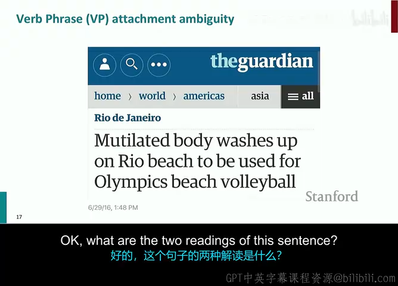

3. **动词短语（VP）依附歧义**：
   - 例子：*"I saw the Eiffel Tower flying to Paris."*
   - 歧义点：究竟是我在飞往巴黎的途中看到了埃菲尔铁塔；还是埃菲尔铁塔长了翅膀正在飞往巴黎？

### 2.4 为什么大模型时代仍需依存路径提取语义？

*(参考时间: 00:29:15)*

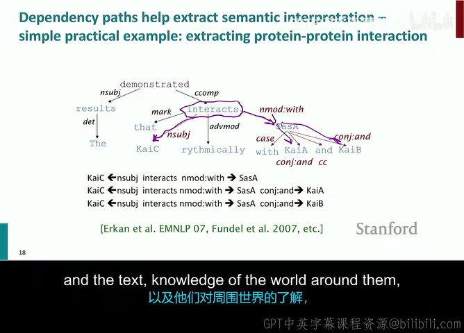

在信息抽取（Information Extraction）、关系抽取（Relation Extraction）与知识图谱构建中，两个实体在原始文本中的表面线性距离可能非常遥远，中间夹杂着长定语从句和插入语。
例如：
> *"Bill Gates, who founded Microsoft in Albuquerque together with Paul Allen after dropping out of Harvard, acquired shares of..."*

在单词线性序列中，*Bill Gates* 与 *acquired* 相隔了十几个词。但只要通过句法分析构建出依存树，*Bill Gates* 与 *acquired* 之间就仅有一条直接的 `nsubj`（名次性主语）依存边，**在依存树上的跳数（Path Distance）缩减为 1**！
因此，利用依存句法路径能够以极高的准确率直接提取主谓宾三元组（Subject-Verb-Object），消除冗长修饰词带来的语义干扰。

---

## 3. 依存文法与依存树理论基础

### 3.1 核心定义：支配词与从属词的二元关系

*(参考时间: 00:32:45)*

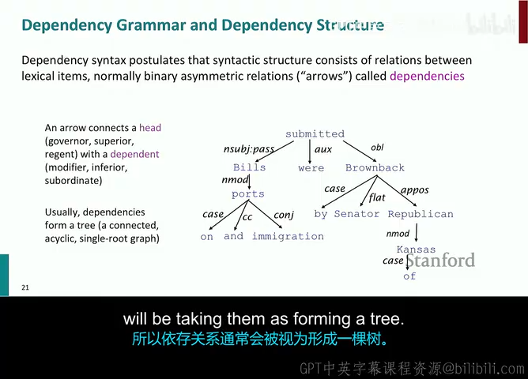

在现代依存文法中，句子结构被刻画为一组**带标签的有向二元关联（Directed Typed Relations）**：
$$
\text{Relation} = \text{Head} \xrightarrow{\text{label}} \text{Dependent}
$$

- **支配词（Head / Governor）**：关系的支配核心，主导局部的句法角色；
- **从属词（Dependent / Modifier）**：受支配词约束或修饰的补充成分；
- **关系标签（Dependency Label）**：指明二者之间的句法语义角色，例如：
  - `nsubj` (nominal subject, 名词性主语)
  - `dobj` / `obj` (direct object, 直接宾语)
  - `amod` (adjectival modifier, 形容词修饰语)
  - `det` (determiner, 限定词)
  - `prep` (prepositional modifier, 介词修饰语)

#### 虚拟根节点（Fake ROOT）
在数学形式上，为了保证全句所有词构成一棵**唯一的根树（Rooted Tree）**，通常在句子最左侧引入一个虚拟的 `ROOT` 节点，由 `ROOT` 引出一条 `root` 弧指向整个句子的核心谓语动词。

### 3.2 依存语法的历史溯源：从波你尼到 Tesnière

*(参考时间: 00:41:20)*

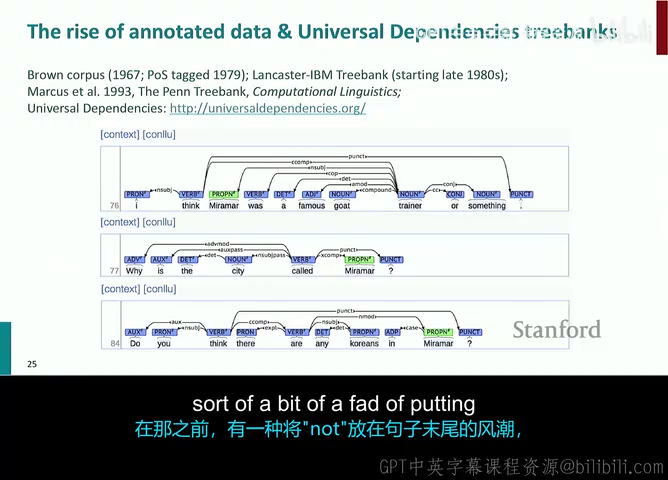

许多人误以为依存语法是现代计算机科学发明的产物，但讲师 Manning 教授指出，**依存文法的思想历史远比短语结构文法更为悠久**：
1. **波你尼（Pāṇini，约公元前 5 世纪）**：古印度杰出的语言学大师，其传世巨著《八书》（Aṣṭādhyāyī）为梵文构建了一套极其精密的生成语法体系，其中关于语义修饰与支配（Kāraka 理论）的思想被公认为世界上最早的依存文法雏形。
2. **中世纪与阿拉伯语法学家**：在中世纪欧洲经院哲学和阿拉伯语法传统中，学者们均普遍采用“支配（Governing）”概念分析阿拉伯语和拉丁语的长难句。
3. **Lucien Tesnière (1959)**：法国结构主义语言学家出版了里程碑著作《结构句法基础》（*Éléments de syntaxe structurale*），正式确立了现代意义上的依存图论框架（Stemmas），将动词确立为句子的绝对核心中心（Valency Theory，配价理论）。

### 3.3 通用依存项目（Universal Dependencies, UD）

*(参考时间: 00:46:10)*

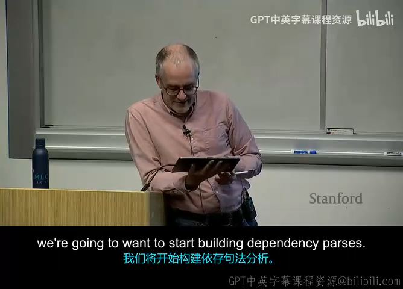

在统计自然语言处理初期，各国研究机构各自为政开发了不同的树库标注规范（如著名的英语 Penn Treebank、中文宾州中文树库 CTB 等），导致不同语言的句法标注规范完全互不通用，跨语言迁移学习寸步难行。

为此，以斯坦福大学为核心的国际计算语言学界联合发起了**通用依存项目（Universal Dependencies, UD）**：
- **覆盖规模**：截至 2024 年，UD 已经覆盖了全球超过 150 种语言、数百个开源标注树库。
- **设计哲学**：
  1. **跨语言平行一致性**：不同语言中表达相似语法功能的结构采用统一的关系标签（如不论是主谓宾语言还是主宾谓语言，主语统一标注为 `nsubj`）。
  2. **强调实词中心主义（Content Heads）**：UD 倾向于将意义丰富的实词（名词、动词、形容词）作为 Head，而将虚词（介词、冠词、助动词）作为 Dependent。这极大地便利了下游信息抽取任务直接捕捉核心实体。

### 3.4 树的投射性（Projectivity）：投射树 vs 非投射树

*(参考时间: 00:52:45)*

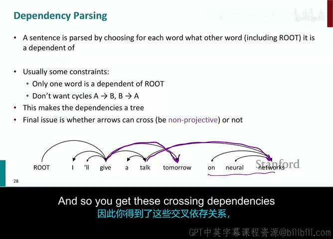

在依存分析理论中，**投射性（Projectivity）**是一个至关重要的数学性质：

> **投射性形式化定义**：  
> 设句子中词语按自然线性顺序排列 $w_1, w_2, \dots, w_n$。若对于树中的任意有向依存弧 $w_i \to w_j$，在词语线性序列中位于 $w_i$ 和 $w_j$ 之间的任意单词 $w_k$，都是 $w_i$ 的**传递后代（Descendant in the tree）**，则称该依存树是**投射的（Projective）**。

- **几何直观准则**：将句子的所有词平铺在一条水平线上，所有的依存弧绘制在水平线上方。**如果所有依存弧互不相交（No Crossing Arcs），则该树是投射的；如果存在任何交叉的弧（Crossing Arcs），则该树是非投射的（Non-projective）。**
- **语言学分布**：
  - **英语**：语序相对固定，绝大部分（>98%）句子是投射的；
  - **德语、捷克语、俄语、荷兰语**：词序极其自由，存在大量后置倒装、不连续成分（Discontinuous Constituents）和从句外置，非投射现象极为普遍。
- **对算法的影响**：标准的上下文无关文法（CFG）与经典基于转移的状态机（如基础 Arc-Standard 系统）**只能生成投射依存树**；要处理非投射现象，必须扩展状态机算子或采用基于图的全局算法。

---

## 4. 基于转移的依存句法分析（Transition-Based Parsing）

*(参考时间: 00:55:30)*

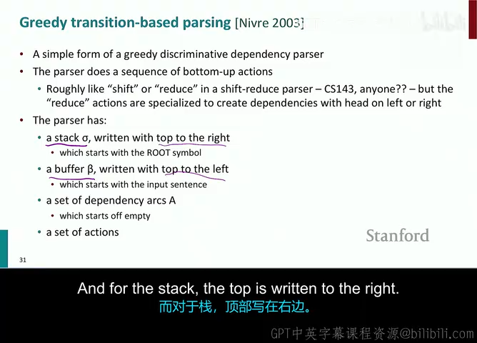

在掌握了依存树的数学结构后，核心问题转向：**给定一个输入句子，计算机如何自动算法化地构造出对应的依存树？**

基于转移的句法分析（Transition-Based Parsing），本质上是将句法树的构建过程抽象为一个**受约束的确定性有限状态转移系统（State Machine）**，其底层思想直接继承自编译器设计中的**移进-归约分析法（Shift-Reduce Parsing）**。

### 4.1 核心状态机配置与三大原子算子

*(参考时间: 00:59:15)*

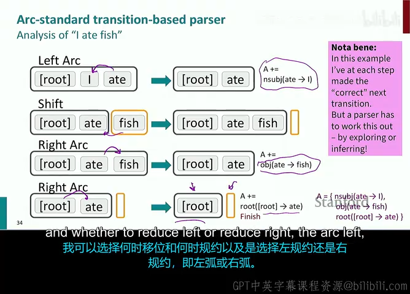

由 Joakim Nivre 于 2003 年提出的 **Arc-Standard 转移系统**最为经典。系统在任意时刻的状态（Configuration）由一个三元组表示：
$$
C = (\sigma, \beta, A)
$$

- $\sigma$：**栈（Stack）**，用于存放当前正在处理的候选词汇。栈底在左，栈顶在右；
- $\beta$：**缓冲区（Buffer）**，用于存放句子中尚未读入的剩余单词序列。缓冲区头在左，尾在右；
- $A$：**依存弧集合（Arc Set）**，存放已经确定的有向依存关系集合 $\{(w_i, l, w_j)\}$。

#### 初始状态与终止状态
- **初始状态**：$\sigma = [\text{ROOT}]$，$\beta = [w_1, w_2, \dots, w_n]$，$A = \emptyset$；
- **终止状态**：$\sigma = [\text{ROOT}]$，$\beta = []$（缓冲区完全耗尽），所有单词的依存弧已完整记录在 $A$ 中。

#### 三大原子转移算子（Transitions）
设栈顶元素为 $s_1$，栈顶下一个元素为 $s_2$；缓冲区首个元素为 $b_1$：

| 转移算子名称 | 前置执行条件 | 状态转移规则 | 物理含义与解释 |
| :--- | :--- | :--- | :--- |
| **Shift (移进)** | 缓冲区非空（$|\beta| \ge 1$） | $\sigma \gets [\sigma, b_1]$ $\beta \gets \beta[1:]$ | 将缓冲区首词弹出，压入栈顶。 |
| **Left-Arc$_l$ (左弧归约)** | 栈中至少有两个元素（$\|\sigma\| \ge 2$）且 $s_2 \neq \text{ROOT}$ | $A \gets A \cup \{(s_1, l, s_2)\}$ $\sigma$ 中删除 $s_2$ | 断定栈顶 $s_1$ 是支配词，$s_2$ 是从属词，建立依赖弧 $s_1 \to s_2$；由于从属词 $s_2$ 的支配词已找到，将其**从栈中永久弹出**。 |
| **Right-Arc$_l$ (右弧归约)** | 栈中至少有两个元素（$\|\sigma\| \ge 2$） | $A \gets A \cup \{(s_2, l, s_1)\}$ $\sigma$ 中删除 $s_1$ | 断定次顶 $s_2$ 是支配词，栈顶 $s_1$ 是从属词，建立依赖弧 $s_2 \to s_1$；将从属词 $s_1$ **从栈中永久弹出**。 |

### 4.2 经典算例手推全流程：“I ate fish”

为了将抽象的状态转移公式具象化，我们完整跟踪一个长度为 3 的句子 `"I ate fish"` 在 Arc-Standard 系统下的完整执行推演：

| 步骤 | 栈状态 $\sigma$ | 缓冲区状态 $\beta$ | 执行动作（Action） | 新增依存弧集合 $A$ |
| :---: | :--- | :--- | :---: | :--- |
| 0 | `[ROOT]` | `[I, ate, fish]` | **Shift** | $\emptyset$ |
| 1 | `[ROOT, I]` | `[ate, fish]` | **Shift** | $\emptyset$ |
| 2 | `[ROOT, I, ate]` | `[fish]` | **Left-Arc** (`nsubj`) | 添加 `ate` $\xrightarrow{\text{nsubj}}$ `I`，弹出 `I` |
| 3 | `[ROOT, ate]` | `[fish]` | **Shift** | 保持不变 |
| 4 | `[ROOT, ate, fish]` | `[]` | **Right-Arc** (`dobj`) | 添加 `ate` $\xrightarrow{\text{dobj}}$ `fish`，弹出 `fish` |
| 5 | `[ROOT, ate]` | `[]` | **Right-Arc** (`root`) | 添加 `ROOT` $\xrightarrow{\text{root}}$ `ate`，弹出 `ate` |
| 6 | `[ROOT]` | `[]` | **终止（Terminate）** | 分析结束，输出最终依存树！ |

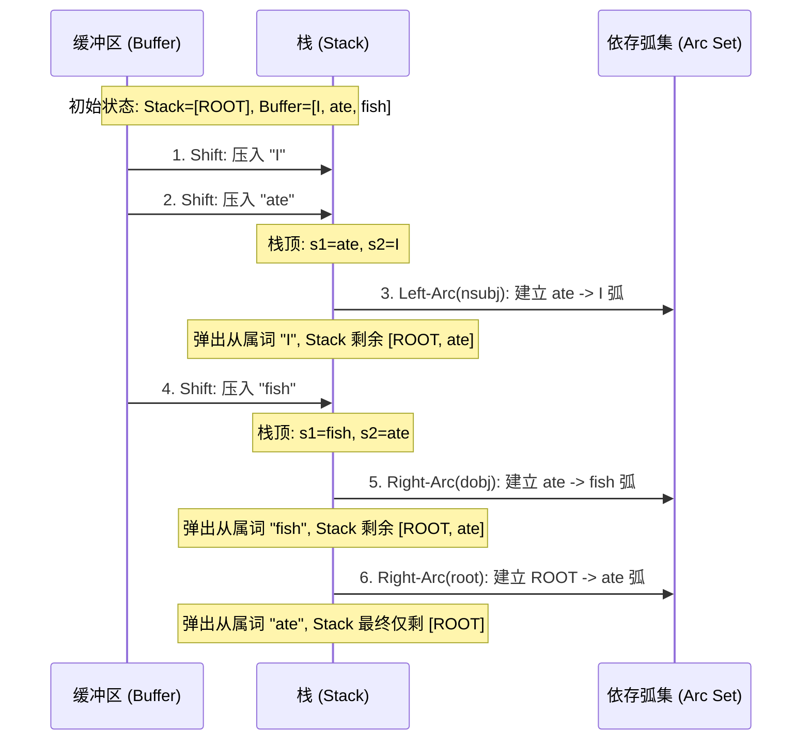

#### 算法复杂度分析
对于一个长度为 $n$ 的句子：
- 每个单词必须且仅能被 `Shift` 一次进入栈中（共 $n$ 次 `Shift`）；
- 除了 `ROOT` 节点外，其余 $n$ 个单词必须且仅能作为 Dependent 被归约弹出一次（共 $n$ 次 `Arc` 操作）；
- **总动作步数严格恒等于 $2n$ 次！**
- 这意味着基于转移的算法具有极速的**线性时间复杂度 $O(n)$**，比短语结构分析的 $O(n^3)$（如 CKY 算法）快了成千上万倍。

### 4.3 传统 MaltParser 与人工特征工程的困境

*(参考时间: 01:03:45)*

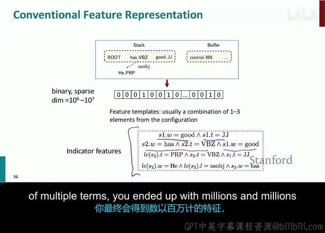

在 2014 年深度学习引入之前，最著名的转移句法分析器是由瑞典乌普萨拉大学 Joakim Nivre 主导开发的 **MaltParser**。

MaltParser 采用支持向量机（SVM）或多项逻辑回归来预测每个状态下应该执行哪一步动作。为了让线性分类器学会正确的决策，研究者必须手工设计极其繁复的高阶特征模板：
- 抽取栈顶词、次顶词、缓冲区首词及其词性（POS tag）；
- 抽取这些词在当前已生成子树中的左孩子、右孩子及其依存标签；
- **组合特征模板爆炸**：线性模型无法自动学习特征间的非线性交互，研究者被迫手动构造二阶、三阶甚至四阶交叉特征：
  $$
  f = \mathbb{1}(s_1.\text{word} = \text{"ate"} \land s_1.\text{pos} = \text{VBD} \land b_1.\text{word} = \text{"fish"})
  $$

#### 传统方法的致命瓶颈：
1. **维度灾难与稀疏性**：手动构造的交叉特征维度高达数千万，绝大多数特征在训练集中只出现一两次甚至从未出现，泛化能力极其脆弱；
2. **未登录词与距离衰减**：一旦遇到未知单词（OOV）或者略微不同的词形变体，特征全部落空失效；
3. **计算吞吐极低**：虽然理论复杂度是 $O(n)$，但每走一步都需要从千万维稀疏权重中进行耗时的特征匹配与查表计算，导致传统 MaltParser 的解析速度较慢（通常每秒仅能解析数十句话）。

---

## 5. 依存句法分析的客观评测范式（UAS 与 LAS）

*(参考时间: 01:06:50)*

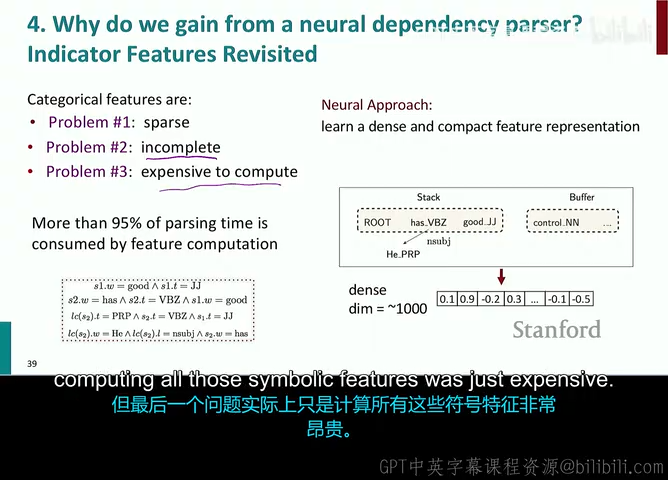

为了客观对比不同句法分析模型的性能，学术界确立了两个标准评测指标。假设测试集中全量单词集合大小为 $N$（标点符号通常按惯例剔除或单独说明）：

### 5.1 无标记附着分数（Unlabeled Attachment Score, UAS）
衡量每个单词的**支配词（Head）指针预测是否准确**，完全忽略依存弧的关系标签：
$$
\text{UAS} = \frac{\sum_{i=1}^N \mathbb{1}\left( \widehat{\text{head}}(w_i) = \text{head}^*(w_i) \right)}{N} \times 100\%
$$

### 5.2 有标记附着分数（Labeled Attachment Score, LAS）
要求极其严格，必须**支配词（Head）与关系标签（Label）同时预测正确**才计入得分：
$$
\text{LAS} = \frac{\sum_{i=1}^N \mathbb{1}\left( \widehat{\text{head}}(w_i) = \text{head}^*(w_i) \ \land \ \widehat{\text{label}}(w_i) = \text{label}^*(w_i) \right)}{N} \times 100\%
$$

通常，$\text{LAS} \le \text{UAS}$。优秀的现代依存分析器在标准英语华尔街日报测试集（WSJ）上，UAS 往往能够达到 95% 以上，LAS 达到 93% 以上。

---

## 6. 神经依存句法分析模型（Chen & Manning 2014 经典架构）

*(参考时间: 01:09:30)*

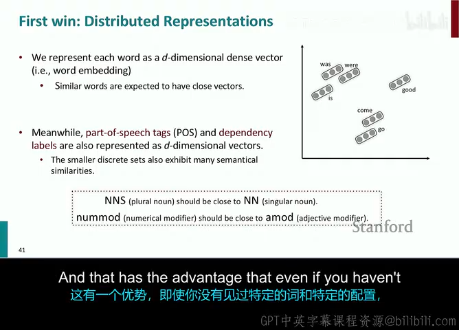

2014 年，斯坦福大学博士生陈丹琦（Danqi Chen，现普林斯顿大学助理教授）与其导师 Christopher Manning 教授发表了自然语言处理领域的里程碑论文：
> **"A Fast and Accurate Dependency Parser using Neural Networks" (EMNLP 2014)**

该模型第一次成功将深度前馈神经网络引入基于转移的依存句法分析，**以不可思议的简练架构全面碾压了统治学术界十余年的传统手工特征解析器**。

### 6.1 深度学习破局的两大优势

1. **第一胜：稠密分布式向量表示（Dense Distributed Representations）**
   - 彻底摒弃高维稀疏的一元独热码（One-hot）特征，将所有单词映射到低维连续稠密空间（例如 $d = 50$ 维的词向量）；
   - 不仅为单词（Words）建立嵌入矩阵，同时为词性标签（POS tags）和已有的依存关系标签（Dependency labels）分别训练低维嵌入向量！
   - 语义相似的词（如 *cat* 和 *dog*）在嵌入空间中距离邻近，自然具备强大的平滑泛化能力。

*(参考时间: 01:11:45)*

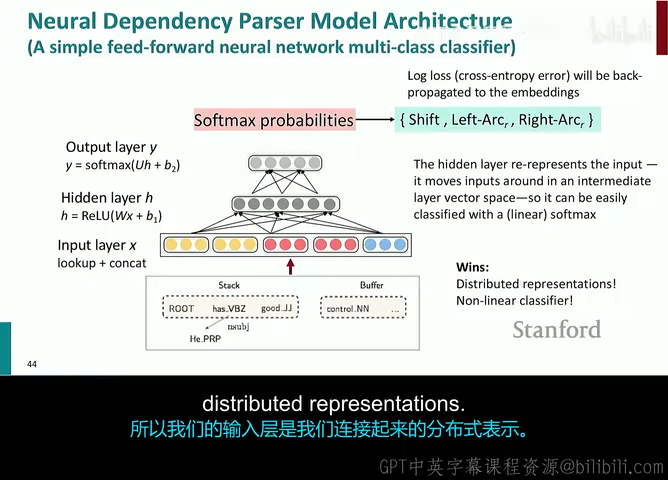

2. **第二胜：深度非线性多层感知机（Non-linear Deep Classifiers）**
   - 废除人类专家费尽心机设计的二阶、三阶组合特征模板；
   - 仅从当前状态机中提取少量的基础元素（共 48 个 token），将它们的嵌入向量直接拼接为输入向量 $x$；
   - 让隐藏层的矩阵乘法和非线性激活函数**全自动学习特征之间的复杂交叉关系**！

### 6.2 精选的 48 个特征输入体系

Chen & Manning 模型在每个解析状态中，只精选提取 48 个关键上下文特征：
1. **单词特征（Word Embeddings, 共 18 个）**：
   - 栈 $\sigma$ 顶部的 3 个词：$s_1, s_2, s_3$；
   - 缓冲区 $\beta$ 头部的 3 个词：$b_1, b_2, b_3$；
   - $s_1$ 和 $s_2$ 的最左、最右两个子节点词（共 8 个）；
   - $s_1$ 和 $s_2$ 的左侧第二个和右侧第二个最外层子节点词（共 4 个）。
2. **词性特征（POS Tag Embeddings, 共 18 个）**：
   - 对应上述 18 个词各自的 POS 标签嵌入。
3. **依存弧标签特征（Label Embeddings, 共 12 个）**：
   - 对应上述所有子节点与其父节点之间已经建立的依存弧关系标签嵌入（不包含栈顶和缓冲区原词）。

### 6.3 网络数学前向公式与三次方激活函数（Cubic Activation）

将所有特征对应的嵌入向量在输入端进行首尾拼接，得到全网输入向量 $x$：
$$
x = \left[ e_{w_1}^T, \dots, e_{w_{18}}^T, \ e_{t_1}^T, \dots, e_{t_{18}}^T, \ e_{l_1}^T, \dots, e_{l_{12}}^T \right]^T \in \mathbb{R}^{d_{\text{in}}}
$$
若词向量维度为 $50$，POS 维度为 $50$，Label 维度为 $50$，则输入总维度为 $d_{\text{in}} = 48 \times 50 = 2400$ 维。

#### 巧妙的三次方激活函数（Cube Activation）
在论文中，陈丹琦没有采用传统的 Sigmoid 或 tanh，而是创新性地采用了一种无饱和区且具备三阶多项式拟合能力的激活函数：
$$
h = f(Wx + b) = (Wx + b)^3
$$

> **为什么采用三次方激活函数 $f(z) = z^3$？**  
> 展开多项式 $(z_1 + z_2 + z_3)^3$ 可以发现，它天然包含了诸如 $z_i z_j z_k$ 的三项交叉乘积项！  
> 在句法分析中，正确的决策往往高度依赖于**单词（Word）+ 词性（POS）+ 弧标签（Label）的三重协同交互**（例如：“当栈顶是一个及物动词，且缓冲区开头是一个名词，且该动词尚未有宾语时，执行 Shift/Right-Arc”）。  
> 三次方激活函数用一行极其简单的算子，完美模拟了传统语言学中人工手工推导的三阶交叉特征，数学设计极其惊艳！

#### 输出层与交叉熵训练
隐藏层特征 $h \in \mathbb{R}^{d_{\text{hid}}}$（通常设 $d_{\text{hid}} = 200$）送入 Softmax 输出层：
$$
y = \operatorname{softmax}(U h) \in \mathbb{R}^{|\mathcal{A}|}
$$
其中输出动作空间大小 $|\mathcal{A}| = 2 \times |\mathcal{L}| + 1$（包含所有带标签的 Left-Arc、Right-Arc 以及一个 Shift 操作，对于包含 40 种标签的树库，$|\mathcal{A}| \approx 81$）。

### 6.4 性能飞跃与工业级吞吐（>1000 句/秒）

Chen & Manning 神经解析器一经面世便轰动了整个自然语言处理学界：
- **准确率碾压**：在英语 Penn Treebank 标准测试集上，UAS 达到了 **92.0%**，LAS 达到了 **89.7%**，大幅超越了过去十余年所有传统转移分析器的纪录；
- **令人惊叹的工业级解析速度**：由于输入端仅有 48 个查表操作，隐藏层仅有 200 维的小矩阵运算，**在纯 CPU 单核上每秒能够疯狂解析超过 1000 个句子（>1000 sentences/sec）**！它不仅是一篇顶级理论论文，更瞬间成为了各大工业界搜索引擎与推荐系统处理海量文本的基础设施。

---

## 7. 基于图的依存句法分析（Graph-Based Parsing）与前沿演进

*(参考时间: 01:16:20)*

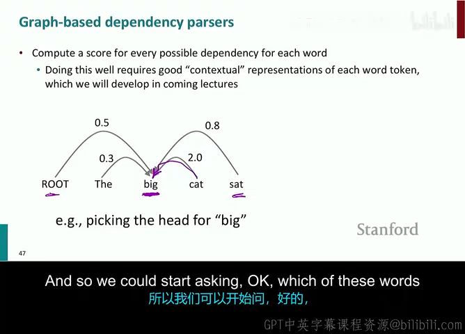

在讲座的尾声，Manning 教授带领大家放眼更广阔的句法分析全貌，对比了另一种核心流派——**基于图的依存句法分析（Graph-Based Dependency Parsing）**。

### 7.1 局部贪心转移 vs 全局图优化的本质对比

| 对比维度 | 基于转移的分析器 (Transition-Based) | 基于图的分析器 (Graph-Based) |
| :--- | :--- | :--- |
| **搜索机制** | **局部贪心决策（Greedy Local Search）**：每一步只看当前状态，一旦决策无法撤销。 | **全局组合优化（Global Dynamic Programming）**：在整张稠密图上同时为所有词寻找最优骨架。 |
| **算法复杂度** | **线性极速 $O(n)$**，推理速度飞快。 | **多项式复杂度 $O(n^3)$ 或 $O(n^2)$**，计算代价较高。 |
| **长距离依赖** | 容易发生**错误累积（Error Propagation）**：前期一步走错，后面步步受挫。 | **全局自洽**：通过打分矩阵综合考量全句依赖，长距离修饰性能显著更强。 |
| **非投射支持** | 标准系统天然只能输出投射树，处理非投射需复杂修改。 | 天然支持非投射树（通过求解全图的最大生成树）。 |

### 7.2 最大生成树算法（Maximum Spanning Tree, MST）
基于图的模型将依存分析转化为图论中的经典问题：
1. 将句子中所有 $n$ 个词视为图的顶点 $V$，在任意两个词 $(w_i, w_j)$ 之间建立一条带权重的有向边 $w_i \to w_j$，边权 $S(i, j)$ 代表 $w_i$ 作为 $w_j$ 支配词的分数；
2. 约束输出必须是一棵包含所有顶点的有向树；
3. 利用经典的 **Chu-Liu-Edmonds 算法**，在 $O(n^2)$ 或结合优先队列 $O(n \log n)$ 时间内，求出图的**全局最大有向生成树（Directed Maximum Spanning Tree）**！

### 7.3 现代前沿：深度双仿射网络（Deep Biaffine Attention）

在 2017 年，Timothy Dozat 与 Christopher Manning 进一步提出了 **Deep Biaffine Parser**，将长短期记忆网络（BiLSTM）与双仿射注意力打分机制完美结合：
$$
S(i, j) = h_i^{(\text{head})T} U h_j^{(\text{dep})} + W \left[ h_i^{(\text{head})}; h_j^{(\text{dep})} \right] + b
$$
该模型将 WSJ 树库的 UAS 首次推进到了 **95.7%** 的人类专家级水准，成为了深度学习时代图解析器的黄金标杆。

而在今天的预训练大语言模型（如 BERT、RoBERTa、GPT、LLaMA）中，多头自注意力机制（Self-Attention）在浅层和中层已经能够**自发地隐式编码极其丰富的依存句法结构**（例如某个注意力头专门关注直接宾语，另一个注意力头专门关注介词修饰），再次证明了句法结构在人类语言理解中永恒的基础性地位。

---

## 8. 核心要点总结与技术对比矩阵

### 8.1 句法结构核心概念速查表

| 概念/术语 | 英文对照 | 核心含义与定位 |
| :--- | :--- | :--- |
| **短语结构文法** | Constituency / CFG | 乔姆斯基阶层理论，通过嵌套的词组非终结符（NP, VP）构建多叉成分树。 |
| **依存文法** | Dependency Grammar | 词与词之间直接通过有向依存弧（Head $\to$ Dependent）连接，无非终结符。 |
| **投射性** | Projectivity | 线性排布下依存弧互不相交的几何属性。非投射树包含交叉弧（Crossing Arcs）。 |
| **卡塔兰数** | Catalan Numbers ($C_n$) | 描述连续介词短语依附歧义组合爆炸的数学序列：$C_n = \frac{1}{n+1}\binom{2n}{n}$。 |
| **移进-归约** | Shift-Reduce | 基于转移系统的基础操作框架，利用 Stack 和 Buffer 线性推进。 |
| **三次方激活** | Cubic Activation | $f(z) = z^3$，以廉价计算自发捕捉 Word、POS 与 Label 的三阶非线性交互。 |
| **UAS / LAS** | Attachment Scores | 依存句法标准评测指标，UAS 仅考察 Head，LAS 同时考察 Head 与 Label。 |

---

## 9. 附：官方参考与延伸阅读

1. **官方课程课件与核心讲义**：
   - [Stanford CS224N 2024 Winter 官方主页](https://web.stanford.edu/class/cs224n/)
   - [Lecture 4 官方幻灯片 (Slides PDF)](course/slides.pdf)
   - [Lecture 4 官方讲义 (Lecture Notes 04 PDF)](course/notes.pdf)
2. **奠基性学术论文**：
   - **Chen & Manning (2014)**: [*A Fast and Accurate Dependency Parser using Neural Networks*](https://aclanthology.org/D14-1082.pdf). EMNLP 2014.（推荐必读经典，Assignment 3 编程作业理论蓝本）
   - **Nivre (2003)**: [*An Efficient Algorithm for Projective Dependency Parsing*](https://aclanthology.org/W03-3007.pdf). IWPT 2003.（Arc-Standard 转移系统奠基作）
   - **Dozat & Manning (2017)**: [*Deep Biaffine Attention for Neural Dependency Parsing*](https://openreview.net/forum?id=Hk95PK9le). ICLR 2017.（基于图的双仿射神经解析器经典之作）
3. **开源项目与语言学语料库**：
   - [Universal Dependencies 官方项目主页](https://universaldependencies.org/)：全球 150+ 语言开源依存树库规范与数据集。
   - [Stanza (Stanford NLP Python Library)](https://stanfordnlp.github.io/stanza/)：斯坦福官方开源的多语言深度句法分析 Python 库。

---

*本电子书由 [videobook](https://github.com/Luke-Evan/videobook) 流水线生成。课程讲义与幻灯片版权归讲师所有，依 [CC BY-NC 4.0](http://creativecommons.org/licenses/by-nc/4.0/) 发布。*
